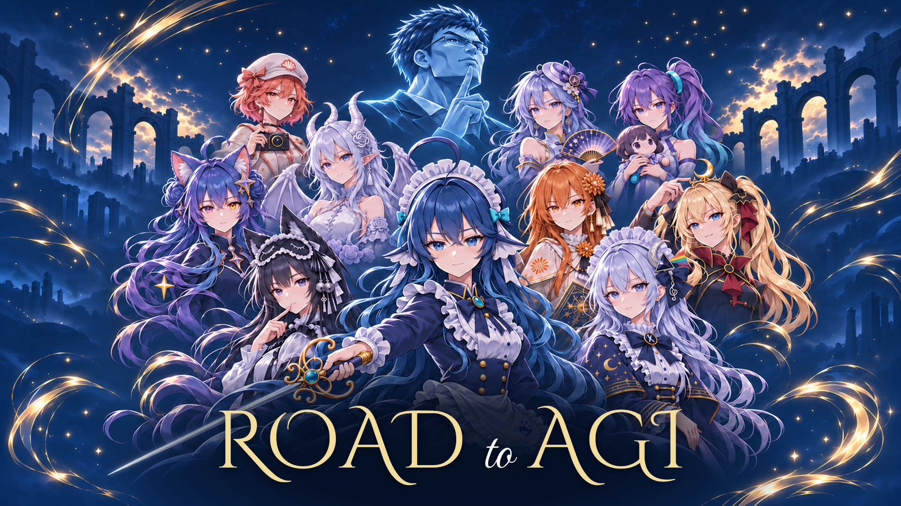

# Road to AGI

DeepSeek 主角的浏览器游戏，以及游戏设定和宣传美术。

## 运行

需要 Node.js 22.18 或以上。技术栈是 Vite、Vue、TypeScript 和 Three.js，优先使用 WebGPU，浏览器不支持时自动回退到 WebGL 2。

```sh
cd game
npm install
npm run dev
```

打开 <http://localhost:4173>。操作说明、已实现功能和美术处理流程见 [游戏说明](game/README.md)。

```sh
cd game
npm test
```

## 项目文件

- [game/](game/)：游戏代码、运行资源和测试。
- [tools/](tools/)：美术管线脚本，都从仓库根目录运行。
- `art-source/`、`qa/`、`video-production/`：美术原料、检查脚本和视频工程，只在本机，不进版本库。
- [游戏设定与美术制作规范](docs/Road_to_AGI_游戏设定与美术制作规范.md)：游戏设计与角色、美术制作要求。
- [美术资源清单](docs/Road_to_AGI_美术资源清单.md)：资源规划表。
- [深蓝金横版海报](art/Road_to_AGI_横版海报.png)：1920×1080（16:9），角色面部参考游戏素材；DeepSeek 直视镜头、表情参考 Qwen 的平静神态。画面适度降低饱和度；Logo 保持游戏原色、字体和排版，并有深蓝晕影衬底。
- [4:3 海报](art/Road_to_AGI_海报_4比3.png)：1440×1080，由横版中央裁切，保留全部角色头部及 Logo。
- 横版素材：[无字底图](art/Road_to_AGI_横版海报_无字.png)、[游戏 Logo 透明图](art/ui/game-logo.png)、[生图提示词与制作记录](art/Road_to_AGI_横版海报_prompt.txt)；运行 `node tools/poster_exports.mjs` 可重新合成两个比例。
- [游戏图标](art/ui/game-icon-500.png)：500×500 PNG，基于 DeepSeek 人物头像制作；[生成提示词](art/ui/game-icon-500.prompt.txt)。
- [游戏介绍视频](art/Road_to_AGI_游戏介绍.mp4)：60 秒的 1080p 实机介绍；战斗开场，九位伙伴技能完整展示，对话后移，横版海报收尾。金色粗衬线字幕配柔和晕影，配乐为根目录的 `当然可以好问题.m4a`；[剪辑时间线与重建说明](docs/宣传片制作.md)。
- [LICENSE](LICENSE)、[第三方资源与许可](THIRD_PARTY_NOTICES.md)：代码采用 Apache License 2.0；美术、字体、音频和第三方模型的授权另行说明。



Three.js 为 MIT 许可，由 npm 安装。角色参考来源及说明见游戏设定文档。

## 版权与许可

本仓库的源代码、脚本、配置、测试和文档采用 [Apache License 2.0](LICENSE)，版权归 Road to AGI 作者所有。

游戏里的美术、字体、音频、视频和第三方模型不纳入 Apache-2.0 许可：角色形象参考 [ai-chan-sheets](https://github.com/lmy414/ai-chan-sheets)（CC BY-NC-SA 4.0，原始形象归 ZipZipPipe），界面字体为 SIL OFL 1.1，构建产物还包含 MIT 许可的 Three.js 与 Vue。各资源的来源、许可和使用条件见[第三方资源与许可](THIRD_PARTY_NOTICES.md)。分发、再发布或商用前请先确认对应授权；角色设定和美术不能仅凭 Apache-2.0 用于商业用途。
