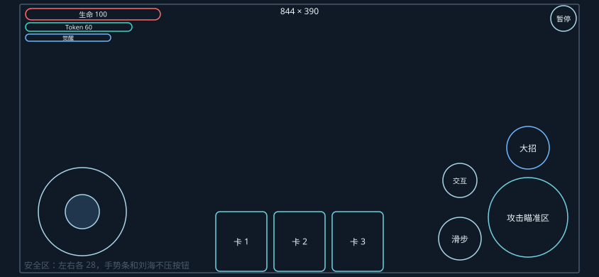
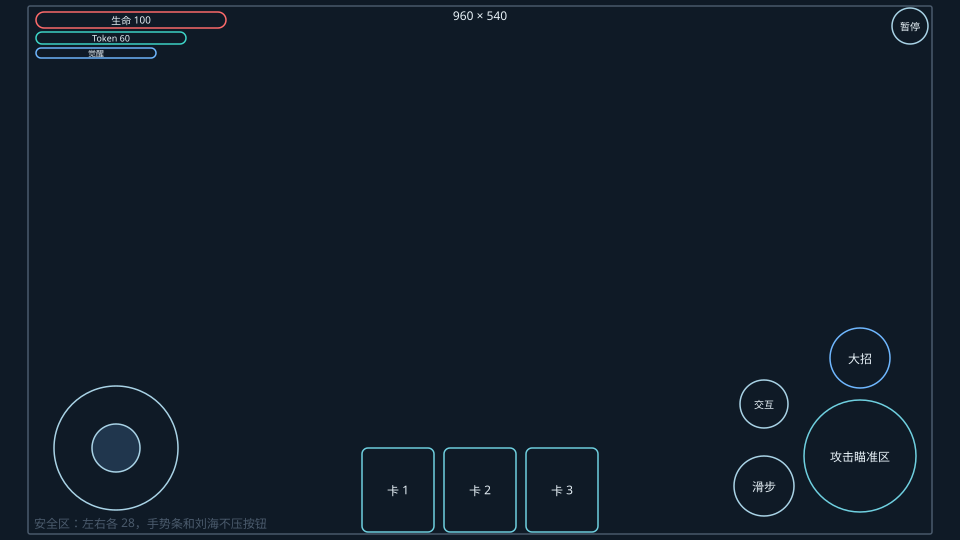
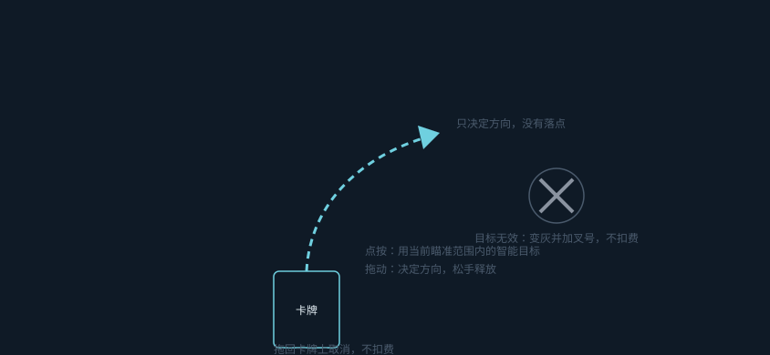
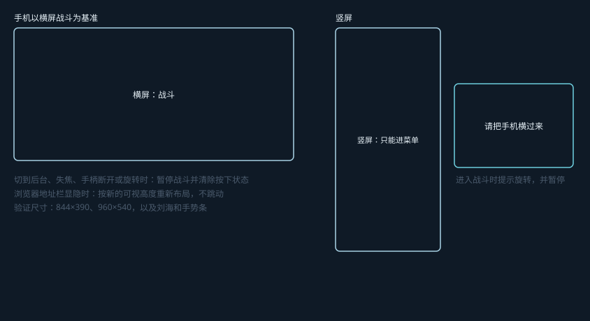
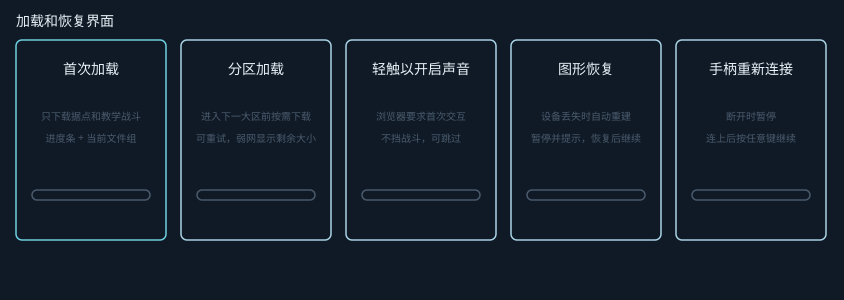
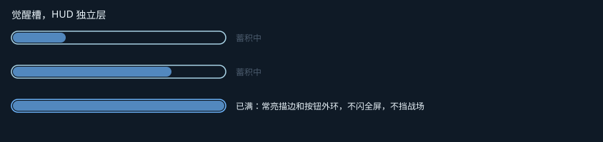

# Road to AGI Web 适配稿

对应资源清单的 ART-193、194、196、198、199、200、201。规则在[设定文档](Road_to_AGI_游戏设定与美术制作规范.md)第2节，这里是布局稿，已接入界面。图是可编辑的 SVG，由 `tools/ui_mocks.py` 生成，单位是 CSS 像素，按钮命中区从 48 起。

## 手机横屏 HUD

## 触屏施法

点按用智能目标，拖动只决定方向，拖回卡牌上不扣费。没有落点，鼠标、手柄和手指都只给方向。目标无效时变灰并加叉号，不只靠红绿区分。

## 横竖屏和安全区

## 加载和恢复

## 觉醒槽

## 角色精灵和脚底投影

角色挂在朝向镜头的平面上，逻辑根节点在脚底，用固定着色。脚底投影是三档柔边贴花：`public/assets/vfx/decal-shadow-small.webp`、`decal-shadow-medium.webp`、`decal-shadow-large.webp`。透明边、深度排序和柱后遮挡要在接入场景模块时验证。
