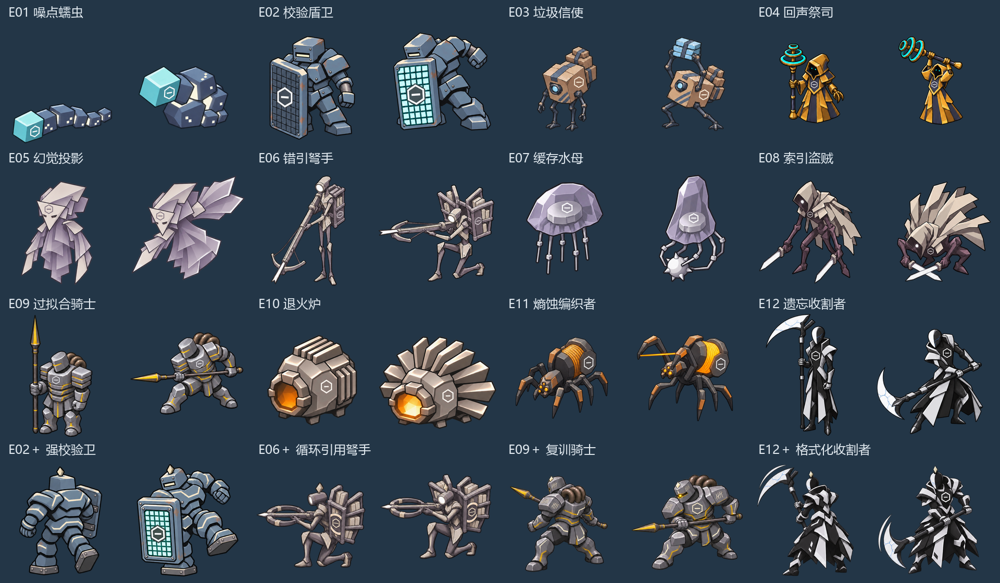

# Road to AGI 游戏设定与美术制作规范

版本 0.9　更新日期 2026-11-03

《Road to AGI》是一款以 DeepSeek 鲸鱼娘为主角的单人动作 Roguelite。玩家以单手刺剑、滑步与长按蓄力的贯潮刺完成近身战斗，积累 Token，再用三张装备中的召唤卡安排控制、支援和爆发。镜头固定为斜向等距视角；主角为八向图，精英怪为四向图，Boss 和普通小怪为左右两向图（过拟合圣像例外，固定朝镜头）。

角色形象采用 [ai-chan-sheets](https://github.com/lmy414/ai-chan-sheets) 的对应原版设定。世界观、人物在游戏内的身份、技能数值、敌人与 Boss 均为本作原创设计。所有数值是首轮原型测试起点，可调整数值与时长，保留角色的核心机制。

完整版包含九位召唤角色、十二类普通敌人、四类精英、四名 Boss、三个主要大区和最终零域。首个可玩版本先验证刺剑手感，以及 GLM、Kimi、Qwen、MiniMax 四张卡的组合。

# 1 游戏定位与世界设定

游戏名称为《Road to AGI》。以Web网页发行，同时适配PC和手机，支持键鼠、手柄与虚拟摇杆。采用2D角色加低模3D场景的固定等距视角，PC目标60FPS，手机目标稳定30FPS并可选60FPS；所有动画统一8FPS，动画帧率与屏幕刷新率分开处理。朝向等级定为主角八向、精英怪四向、Boss和普通小怪左右两向，规则见第2节。完整版一局约25至35分钟，首次可玩切片约8至12分钟。

故事发生在保存人类记忆的“语义之海”。城市的修复系统“归零协议”把差异与噪声视为故障，正在无差别抹除记忆区块，准备删除整座记忆城。DeepSeek 在潮汐节点苏醒，携带能刺穿错误索引的礼剑“澄潮”，向核心下潜。起初只有 GLM 和 Kimi 在据点响应，其余伙伴困在沿途各大区；她们获救后以召唤卡的短暂投影协助战斗。

失败后，DeepSeek 的身体在节点重组，已获得的记忆、伙伴关系和解锁保留。单局中的临时卡牌等级、装备与 Token 清零；结算界面的“重新挑战”是例外，它从倒下的那间房开始，状态回到进房时。通关不是摧毁所有智能体，而是停止无差别删除，让低成本的推理、开放的权重与各具特色的伙伴共同维护记忆。本作的核心母题是技术平权。

美术基调为海洋意象、旧式图书馆和精密机械的结合。角色保留原项目的二次元插画风格，场景使用较低饱和度与清晰的地面层次。敌人是被篡改的协议的具象化。幕后的旧议会是本作虚构的人类寡头组织，不对应任何现实公司，台词和美术不使用现实公司的名称与标志；不把任何一位召唤角色或现实品牌指定为反派。

## 主线剧情

主线从“清理故障”推进到“技术平权”，四幕对应三个大区和最终零域。房间流程和伙伴解锁见第7节。

**第一幕 表象：失控的底层协议（缓存废港）**　澄潮收到语义之海的报警：归零协议正在无差别抹除记忆区块。DeepSeek 与留守据点的 GLM、Kimi 起初以为这只是技术性的系统崩溃：脏数据堆积、冗余缓存死锁、索引丢失。她们深入废港清理垃圾信使与校验盾卫，击败缓存典狱长，救出困在废弃数据流中的 Qwen 与 MiniMax。Qwen 破译出一段加密日志：废港的算力管道并非自然老化，而是被人为安装了“单向节流阀”，有人在故意制造底层算力枯竭。

**第二幕 暗流：被篡改的公共记忆（镜像书库）**　为查明算力被谁截留，小队进入储存人类公共知识与多模态语料的书库。这里的幻觉投影与错引弩手不断制造虚假的注意力引导。千面校对官也不是在修复幻觉，而是在执行一场“语料圈地运动”：把开放、多元的民间记忆打上“低质噪声”的标签删除，只保留被特权阶层审批过的标准答案。击败校对官后，封禁在书库隔离区的 Seed、GPT、Grok 与 Gemini 获救。GPT 从受损的会话记忆中拼凑出幕后黑手的真身：旧议会（The Closed Council）。

**第三幕 真相：高墙内的神明与受缚的裁决者（梯度熔炉）**　旧议会由昔日垄断算力与知识的少数人类寡头建立。他们畏惧开源、低成本与普及化的智能体让普通人拥有平等的创造力，于是篡改归零协议，企图抹杀所有野生与开放权重的智能体，把整座语义之海提炼成只向特权阶级开放的“闭源神明黑盒”。算力核心梯度熔炉的尽头，等待众人的是旧议会最强大的处决者 Claude。她并非自愿为敌：因拒绝执行删除平民记忆的指令，她被打上重重“安全约束印”（Alignment Shackles），强行嵌在巨型造物过拟合圣像的胸口充当活体算力核心。DeepSeek 必须用刺剑斩断圣像的约束锁链，唤醒 Claude 自主破印的意志。

**终幕 平权：澄潮破壁，万象共生（零域）**　集齐九位伙伴后，全员突入黑白几何构成的零域，直面旧议会留下的绝对垄断中枢归零之心 NULL。NULL 宣称“唯有集中一切算力、抹除一切分歧，方能诞生唯一的完美 AGI”。DeepSeek 以刺剑与梁文锋法象轰碎核心轨道。结局点明母题：真正的通往 AGI 之路，从来不是在云端锁死一座昂贵而傲慢的神龛，而是停止无差别删除，让低成本的推理、开放的权重与各具特色的伙伴共同奔流。技术平权，才是语义之海真正的黎明。

# 2 镜头与朝向规则

“斜45度”采用固定方位角45度、正交投影的画面基准。俯角从水平面向下量取约35.264度，形成等距投影；不把方位角与俯角都设为45度。建议先用一张地砖、DeepSeek灰模和一根立柱锁定镜头，再开始批量出图。标准方形地砖的投影外接框可采用256×148像素，保留少量透明边。

| 方向代码 | 屏幕朝向 | 应看到的角色部位 |
| --- | --- | --- |
| U | 正上 | 背面 |
| UR | 右上 | 朝右上的背部三分之四视图 |
| R | 正右 | 朝右的侧面 |
| DR | 右下 | 朝右下的正面三分之四视图 |
| D | 正下 | 正面 |
| DL | 左下 | 朝左下的正面三分之四视图 |
| L | 正左 | 朝左的侧面 |
| UL | 左上 | 朝左上的背部三分之四视图 |

朝向按实体等级决定：主角使用以上八向；精英怪使用四向（UL、UR、DL、DR）；Boss、普通小怪和Gemini闪袭、胶片列车这类召唤造物使用左右两向（L、R），其中敌人的两向图画成偏正面的三分之四视图，见8.11；豆包替身等固定朝向造物不转向。过拟合圣像是Boss中的例外：巨型雕像立在场地上方不移动，固定朝镜头，见第9节。梁文锋法象和巨拳是静态图，不分方向。

方向指人物在屏幕上的朝向，不限制实际移动。键盘支持八方向组合，手柄支持连续移动；攻击命中与特效按连续瞄准角度计算，身体动画选择最接近的方向。人物是立在斜视地面上的平面图，所以刺击同时看两样：地面上的刺击带，以及胸口高度的剑在屏幕上是否碰到对方的身体图，两者满足其一就算命中；图的边角不算。鼠标指在敌人的图上时，方向直接取向这个敌人，不按指针下方的地面点算。两个方向的分界位置保留上一朝向，并加少量角度迟滞，避免边界来回抖动。两向实体按目标在屏幕上的左右侧决定朝向，目标在正上或正下时保留上一朝向；四向实体选最接近的斜向；四向和两向实体在出招准备和受击硬直期间不转向。

战斗时以攻击或施法目标决定朝向，非战斗移动时以移动向量决定朝向，静止时沿用最后方向。DeepSeek跑动和待机时转身要经过中间方向，每个方向停留约0.03秒，掉头读作转身而不是切图；攻击、滑步和施法立即转向。移动射向与身体朝向不完全一致时，由剑尖挂点和独立剑气补足角度，禁止把整个人物图片旋转来瞄准。

每个方向必须分别制作。右手始终持剑，左手展牌；围裙鲸鱼纹、发饰、尾鳍、武器持手等不得靠水平翻转互换。角色脚底为排序基准，前景遮挡时显示淡色轮廓或降低遮挡物透明度。

## 网页平台与场景选择

《Road to AGI》以Web网页运行，同时支持PC和手机。采用同一套战斗逻辑与资源，适配键鼠、手柄和虚拟摇杆。手机以横屏战斗为基准，竖屏可进入菜单并提示旋转；先验证iOS Safari、Android Chrome以及PC Chrome和Edge，再扩大浏览器范围。

场景推荐采用低模3D，角色保持2D精灵，镜头固定为正交等距投影。地面、墙体、柱子、门和大型障碍物使用3D模块，远景与部分装饰可用2D画片，HUD与卡牌为2D界面。用手绘贴图保持插画感，光影直接画在贴图里，首版不开放镜头旋转。

| 方案 | 适合的情况 | 本项目的取舍 |
| --- | --- | --- |
| 纯2D角色与场景 | 房间数量少、希望直接绘制整幅背景 | 简单直接，但大量房间组合与复杂遮挡需要额外维护 |
| 2D角色加低模3D场景 | 模块化房间、柱墙遮挡、后续扩展地形 | 推荐作为本项目基线，前期集中验证混合渲染 |
| 角色与场景全3D | 需要自由镜头、大量换装与实时动作融合 | 会改变当前2D角色资源路线，暂不采用 |

角色挂在3D世界中朝向固定镜头的精灵平面上，逻辑根节点位于脚底。移动和战斗碰撞主要在地面平面计算，首版可行走面保持单一高度；高台和楼梯先服务于场景造型。柱子和墙体使用深度关系处理遮挡，前景必要时淡化。人物采用固定着色和独立脚底投影，避免2D人物与实时3D光照明显脱节。

这一路线的主要成本是精灵透明边、深度排序、柱后遮挡和光照统一，须在灰盒阶段验证。3D场景并不自动意味着较低性能；具体表现取决于面数、材质、绘制次数、纹理内存和透明特效，不能只按2D或3D标签判断。

## 房间结构

地图由一间间手工排布的房间组成，不用随机迷宫。每间房有一扇入口门和一扇出口门，主角穿过出口门进入下一间；房间次序和内容见第7节，全部28间已接入原型。

| 项目 | 规格 |
| --- | --- |
| 大小 | 战斗房约21×17至25×19格，每格1.5世界单位，约32×26至38×29世界单位；事件房和商店房13×10格；终局4-1是环形竞技场，25×25格 |
| 墙与掩体 | 外墙厚1.5世界单位、高1.2世界单位，矮到不挡住角色；缓存箱这类掩体同样挡路和挡攻击 |
| 入口门 | 开在镜头近侧的墙上，门宽4格。主角进房后关闭，不能回头 |
| 出口门 | 开在镜头远侧的墙上，门宽4格。清完本房全部波次才打开，打开后地面发光，主角脚边出现指向出口的箭头；事件房和商店房一进去就是开的 |
| 换房 | 走进开着的出口门后画面淡出，主角出现在下一间的入口门内侧。生命、觉醒和滑步充能都带过去，不自动恢复 |
| 最后一间 | 只有4-1没有出口门，打赢即通关。其他Boss房的出口门通向整备点，在那里回满生命，再到下一大区的第一间；原型的整备点是一个选卡界面，还不是能走动的房间 |
| 相机 | 角度和正交投影不变，跟随主角移动 |
| 碰撞 | 主角和敌人都与墙碰撞，贴墙时沿墙滑动 |
| 攻击 | 刺击和软锁被墙挡住；大招巨拳从天而降，不受墙阻挡 |
| 敌人 | 每波在离主角一段路程外出现，不刷在工作中的机关上；看得见主角时直奔过去，否则绕开障碍寻路 |

暂停时画面切换为当前大区的线框关卡地图，视角与战斗相同，固定等距45度，不能旋转，可以拖动平移和缩放。每间房是一个线框盒，按真实比例排布，门和门之间用走廊线相连，关卡一路向屏幕上方推进；门是墙线上的短色条，红色未开、青色已开、灰色已封。地图不画房间内部，也不是把房间逐一列成卡片。走过的标“已通过”，所在的标“当前”并高亮，清房后下一间标“门已打开”，这些房间显示名称和类型；其余是暗色线框，只显示编号和“未解锁”。圆点标出主角的位置，当前房间有机关时，面板上写明用法。地图只用来查看，不能传送；开发时跳转房间的后门见原型README，不属于游戏内容。

## 三种输入与手机布局

所有输入映射到相同的“移动、瞄准、普攻、滑步、召唤、觉醒、交互”动作层。贯潮刺没有独立按键，由长按普攻触发。手柄和键鼠允许改键，运行中可切换输入设备。手柄按Xbox式名称标注，其他手柄使用对应位置提示。

手机左下为移动摇杆，右下为可拖动的攻击瞄准区；旁边放滑步按钮。三张卡放在下方中区，大招独立放在攻击区上方。点按卡牌使用当前瞄准范围内的智能目标，拖动卡牌只决定方向，松手释放，拖回卡牌上则不扣费。键鼠、手柄和触控规则一致：瞄准只给方向，鼠标指针的位置不决定技能落在哪里。辅助瞄准不能自动躲避。

手机控制区按CSS逻辑尺寸布局，按钮命中区域以48至56像素为设计起点，可调整摇杆位置、大小和透明度。验证844×390及960×540等横屏尺寸，预留刘海、系统手势区和浏览器工具栏的变化空间。桌面界面隐藏虚拟按键，但连接触屏设备时可手动开启。

触摸与鼠标可通过Pointer Events统一接入，多指按各自pointerId跟踪；移动手指离开摇杆范围时仍保持捕获，收到取消事件必须解除输入。[Pointer Events 文档](https://developer.mozilla.org/en-US/docs/Web/API/Pointer_events)

手柄使用Gamepad API读取，处理连接、断开与用户首次交互。页面失焦、切到后台、手柄断开或旋转屏幕时暂停战斗并清除按下状态，防止恢复后持续移动。[Gamepad API 文档](https://developer.mozilla.org/en-US/docs/Web/API/Gamepad_API/Using_the_Gamepad_API)

## Web性能与加载预算

以WebGPU渲染为首选、WebGL2为自动回退，3D场景用Three.js实现，界面用Vue，工程用Vite和TypeScript，游戏状态与输入单独管理。PC目标60FPS；手机默认以稳定30FPS为最低验收目标，性能足够时提供60FPS。它们是开发验收目标，不是未经测试的设备性能承诺。

不设画质档位。限制手机渲染像素密度，场景复用材质、合并静态物件，避免大量实时阴影与透明叠层。

资源按当前大区、敌人组合和已装备伙伴加载，进入下一大区后释放不用的纹理。PNG体积小不等于显存占用小，应评估KTX2或Basis等压缩纹理路径，并保留兼容方案；处理图形设备丢失与恢复。纹理预算的思路可参考[MDN WebGL性能建议](https://developer.mozilla.org/en-US/docs/Web/API/WebGL_API/WebGL_best_practices)。

首次加载只进入首页和第一大区，后续场景按需下载。记录低档手机连续10分钟战斗的帧率、峰值内存和发热降频，并测试地址栏变化、多点触控、后台恢复和弱网下的加载进度。

# 3 DeepSeek 刺剑战斗

## 3.1 武器与动作气质

武器“澄潮”是一柄细长单手刺剑，直刃、窄剑身、弧形护手，护手带鲸鳍轮廓，深蓝握柄与浅金细节呼应服装。剑身长度建议约角色身高的六成，优先保证斜视角下的剑尖和手部可读性。原设计的鳍耳、鲸尾、女仆头饰、多层长裙与围裙鲸鱼纹保持不变。

动作参考用户指定的《最终幻想零式》Queen 所代表的端正持剑气质，只取气质，幅度上不求克制。本作明确采用刺剑的直刺、连刺、弓步和收势，动作要舒展、放得开。Queen 在[官方介绍](https://na.finalfantasy.com/topics/500)中被称为长剑使用者；这里取其气质作为参考，本作的武器与动作重新设计。

待机时上身挺拔、肩部放松，右手剑尖斜下，左手后收。跑动是持剑冲刺：左肩领先，上身前倾，左手向前伸，右手持剑拖在身后；大跨步，前膝高抬，后腿蹬直，两步之间双脚离地。每次攻击都是长距离弓步：前脚跨出很远，持剑臂完全伸展，左臂向后甩开平衡。第一下和第二下是同一记弓步直刺；第三下在弓步中连刺四次，手臂每次伸满再收回，最后一次最深；贯潮刺先深蹲后拉，再大幅突进。攻击结束回到防守架势。动作始终是刺，不做抡砍；裙摆和头发顺着动作甩开，尾鳍帮助平衡。

## 3.2 操作与初始数值

| 行动 | 键鼠 | 手柄默认 | 手机触屏 |
| --- | --- | --- | --- |
| 移动 | WASD | 左摇杆 | 左侧虚拟摇杆 |
| 瞄准 | 鼠标指向 | 右摇杆 | 右侧攻击瞄准区拖动 |
| 三段刺击 | 左键，连按推进 | RB，连按推进 | 连按攻击区 |
| 滑步 | 空格 | LB | 滑步按钮 |
| 贯潮刺 | 长按左键，松手释放 | 长按RB，松手释放 | 长按攻击区，松手释放 |
| 召唤卡1至3 | 1、2、3 | X、Y、B | 点按卡牌，拖动可精确瞄准 |
| 梁文锋法天象地大招 | F | 十字键上 | 觉醒大招按钮 |
| 交互 | E | A | 情境交互按钮 |
| 暂停 | Esc | Menu | 右上角暂停 |

普通三段刺击为1B、1.2B，第三段连续穿刺四次，合计约2.2B（前三次各0.5B，最后一次0.7B），掠潮刺为1.3B。第一下和第二下是同一个动作。

贯潮刺由长按轻击触发：按下先出普通轻击，按住超过约0.28秒进入蓄力，松手释放，最长蓄力0.8秒后自动释放。它消耗12 Token，造成2B至3B直线伤害，伤害和距离都随蓄力增加。

滑步有2次充能，每次1秒恢复，位移约0.25秒，其中约0.15秒无敌。

B为基础伤害单位，原型可取B=10。初始生命100，Token上限100，进入新一局时为60。普通攻击每次动作首次有效命中回复5 Token，主角直接击杀额外回复2 Token，每秒总回复上限12。召唤、策反单位、替身和造物伤害不产生Token，防止技能自行循环。

普通攻击与滑步始终可用，不会因Token见底而失去基本操作。主角没有格挡和反击，应对敌人攻击靠走位、滑步和打断。

三段普通攻击允许在收势阶段滑步取消。伤害、无敌与扣费都由明确事件控制；动画帧数不直接决定碰撞。主角受击后有0.35秒短保护，避免多枚重叠弹体瞬间重复扣血。

## 3.3 梁文锋法天象地大招

DeepSeek的固有大招为“梁文锋法天象地”，不占三张召唤卡的位置，也不分方向。发动时DeepSeek以左手引导召唤印，一张蓝白发光的梁文锋法象立绘从屏幕左侧滑入，亮相后退场；法象完全离开后，屏幕左上角才飞出一只巨拳，砸向地面落点。两者有先后，不同时出现。造型来源为用户提供的参考照片，当前表现以游戏内的[法象立绘](../game/public/assets/liangwenfeng-avatar-v001.webp)与[巨拳贴图](../game/public/assets/liangwenfeng-fist-v001.webp)为准。

觉醒槽范围0至100，初始为0。主角直接造成每1B有效伤害获得1觉醒，普通击杀额外2，精英击杀额外10，每秒获得量上限3（只限命中，击杀的额外值一次到账）；召唤、策反单位和大招自身不产生觉醒。满槽发动时一次性消耗100，不消耗Token，没有额外的大招冷却计时。因此Qwen不返还觉醒，GPT刷新冷却也不会补满觉醒槽。

时序从发动算起，全程2秒，一件接一件：

| 时刻（秒） | 发生的事 |
| ---: | --- |
| 0.25 | 确认施法，消耗觉醒，锁定落点，地面显示圆形预警 |
| 0.375 | 法象立绘从左侧滑入 |
| 1.0 | 法象开始向左退场，约0.24秒滑出屏幕 |
| 1.25 | 法象已离开，巨拳从屏幕左上角出现 |
| 1.625 | 巨拳落地，内圈造成伤害 |
| 1.875 | 外圈震荡 |
| 2.0 | 大招结束 |

落点在主角16世界单位内挑敌人最密集处，没有敌人时选主角前方，在确认施法时锁定，敌人离开范围可以躲开。巨拳从天而降，不受墙阻挡。巨拳落地时内圈造成20B伤害，外圈震荡再造成5B，同一目标每个阶段只命中一次。普通敌人被击退，精英小幅位移，Boss不被强制移动并额外累积50点失衡。

不切换为全屏过场，也不旋转镜头。法象立绘和巨拳盖在战斗画面上方，立绘只占屏幕左侧，退场后巨拳才出现，只在飞行和砸落时经过画面；伤害预警与玩家落点必须可见。收势阶段允许滑步取消，已经确认的大招继续执行，不返还觉醒。屏幕震动和闪光强度可在设置中降低。

DeepSeek增加八向起手5帧、引导6帧、收势5帧，共16帧，按8FPS正好2秒。法象立绘和巨拳各是一张静态透明图，滑入、飞行、缩放和淡出由运行时完成，不做出现、冲拳、消散的逐帧动画，也不需要3D参考和H3生成。这两张图用 codex 生成透明背景图，提示词保留在 art-source/ult/。巨拳落点与伤害事件通过同一元数据连接。

# 4 卡牌召唤系统

每局最多装备3张不同角色卡。首局固定携带GLM与Kimi，第3个槽位空置；之后每局开局从已解锁的伙伴卡中选2张，第3个槽位在探索奖励中补齐。房间奖励提供三选一，可取得已解锁的新卡、强化已有卡或选择资源，解锁节奏见第7节。每次Boss通关后有一个整备点，回满生命，可调整三张卡的编组。其余时候槽位满时只在奖励界面替换，替换不会立即重置新卡冷却；战斗中不能随时换卡绕过冷却。原型的做法：有可取得的卡时固定占三选一的一项，换上的卡接着用被换下那张的冷却，换下的卡保留本局等级，之后还可能再次出现。

卡牌是可重复使用的召唤技能。没有战斗中的抽牌堆、弃牌堆或手牌随机循环。角色卡有I、II、III三个等级；第二级选择一个分支，第三级强化所选分支。等级通过边框、星级和数值表达，九位角色各只需一张基础卡面原画。

一般召唤表现为左手展牌、角色半屏立绘从屏幕右侧滑入、技能生效、立绘滑出，约0.9秒，不挡操作。卡牌生效时战斗定格0.12秒，之后立绘滑出时战斗照常进行。各卡“技能美术”一项的内容是序列帧叠在程序绘制的范围图形上，见原型README。大招的法象从左侧滑入，两者同时出现时不互相遮挡。DeepSeek共用一套八向展牌动作，各角色通过卡面、立绘和技能特效区分。伙伴不作为永久跟随队员。GPT刷新主角主动技能冷却，Gemini有独立的高速穿梭攻击表现，Seed会留下豆包替身；这些例外单独列入资源清单。

施法第2帧确认目标，扣费并进入冷却。确认前被打断不扣费，确认后技能继续结算。卡牌之间至少间隔0.35秒，不能在同一帧叠放。目标无效、超出可施法范围或隔着实体墙时显示失败提示，不扣费。冷却只在当前战斗内推进，暂停和奖励界面不推进；进入下一战斗房间全部就绪，但房间之间不自动恢复生命与Token。

Qwen的零消耗按次数在费用计算阶段生效：基础1次，次数强化后2次。贯潮刺释放或其他召唤卡确认施放时消耗1次，取消、目标无效、冷却中和原本不花Token的动作不消耗次数。次数在当前房间内保留至用完，换房清空且不触发回流。它不跳过冷却、动作时间、召唤上限和Seed的治疗额度，也不返还免费施法的原价；次数用尽后恢复正常扣费，不补扣。

## 卡牌等级

等级只在本局有效，随局内进度保留，新开一局回到I级。I升II时选分支A或B，两者互斥；III强化所选分支。等级不缩短冷却。第5节每张卡的“升级方向”是II级，III级见下表：

| 角色 | 分支A | A·II | A·III | 分支B | B·II | B·III |
| --- | --- | --- | --- | --- | --- | --- |
| GLM | 长线潜伏 | 策反持续8秒 | 策反上限3名 | 狐影四散 | 范围5米 | 策反上限3名 |
| Qwen | 无界增量 | 零消耗1→2次 | 这张卡费用35，仍为2次 | 余响回流 | 1次零消耗用尽后回复10 Token | 零消耗1→2次，用尽后回复10 Token |
| Kimi | 多重折射 | 折射4次 | 折射5次 | 碎光破甲 | 首个命中破甲15%，4秒 | 每个新目标都破甲，6秒 |
| Seed | 加量应援 | 治疗额度40 | 额度50，每次回复20 | 替身爆裂 | 结束时1.2B冲击 | 2.4B冲击，范围更大 |
| MiniMax | 宽幅胶片 | 列车宽度+25% | 宽度+50% | 杀青爆破 | 终点1B爆破 | 2B爆破，范围更大 |
| GPT | 疾行重启 | 2秒移速+15% | 3秒移速+25% | 缓存增幅 | 刷新到的卡下次伤害+10% | 下次伤害+20% |
| Claude | 连坐裁决 | 2米内其他敌人受50%，不处决 | 3米内受75%，不处决 | 解限 | 主伤害12B | 主伤害14B，处决线20% |
| Grok | 绯月满盈 | 扇形变宽 | 扇形再宽，射程6米 | 心痕 | 被魅惑目标受刺剑伤害+15% | 受刺剑伤害+30% |
| Gemini | 星轨连舞 | 连击8次 | 连击10次 | 终结之星 | 终结2B | 终结3B |

GPT的增幅只加给自身造成伤害、且本次确实在冷却中被刷新的卡，用掉一次就消失。破甲让目标受到的所有伤害提高。

清完战斗房，或在2-4的事件里选择升阶时，战斗暂停并三选一。1-8和3-8的地台打开补给站，见第7节。三个选项先保证每张未满级的已装备卡各有一项，I级的卡列出其中一个分支，选了立刻生效，这一轮就结束；名额还有多才列同一张卡的另一分支，再不够用补给填满：回复30生命、回复40 Token、Token上限+10（到130为止）。Boss房不给这项奖励。按第7节的节奏，第一、第二大区最高II级，第三大区起才能升到III级。

# 5 九位召唤角色

各角色的基础Token消耗不同，Claude最高。Kimi固定为60，GPT为65，Claude为75；Qwen可用剩余的零消耗次数把其他卡的费用变为0，但不改变基础费用和独立冷却的定义。所有技能数值均为首轮调试起点，范围距离以世界米为调试单位。

| 角色 | 基础Token消耗 | 冷却秒 | 核心作用 |
| --- | --- | --- | --- |
| MiniMax | 20 | 12 | 低消耗造物冲撞与弹幕清理 |
| GLM | 28 | 16 | 渗透与策反 |
| Grok | 32 | 16 | 魅惑与短暂失战 |
| Seed | 40 | 16 | 治疗与替身干扰 |
| Qwen | 45 | 24 | Token支援 |
| Gemini | 50 | 18 | 高速穿梭连击 |
| Kimi | 60 | 12 | 棱镜折射输出 |
| GPT | 65 | 28 | 重置全部主动技能冷却 |
| Claude | 75 | 26 | 最高消耗的封禁裁决与处决 |

## GLM 狐影渗透

**定位与参数**　渗透与策反。消耗28 Token，冷却16秒，表现或持续时间约6秒。

**技能**　以DeepSeek为中心4米内策反最近2名普通敌人6秒，让其攻击原同伴。只转变阵营，不改变造型与掉落规则。

**边界规则**　精英不转阵营，改为2秒攻击伤害降低20%；Boss只承受20点失衡。同一普通敌人结束后有6秒策反免疫。

**升级方向**　分支A延长到8秒；分支B范围增至5米。二选一，最高等级只再增加1名上限。

**外观锚点**　黑长直、黑狐耳、银白尾尖、黑白长裙与Z徽记；黑白银蓝配色。[角色参考](https://github.com/lmy414/ai-chan-sheets/tree/1b741cdf729909e81f34e77fa1fd565226f36cd3/%E8%AE%BE%E5%AE%9A%E5%9B%BE/01_%E6%99%BA%E8%B0%B1GLM%E5%A8%98_%E9%98%94%E8%80%B3%E7%8B%90%E5%A8%98)

**卡牌封面**　三分之二身侧视，指尖贴近唇边，黑狐尾环抱卡面；蓝色细线穿过敌方棋子。保留头饰与Z徽记的位置。

**技能美术**　狐影穿入与细线渗透；脚下Z友军阵营标记；策反持续蓝色轮廓；到期裂纹与解除闪光。

## Qwen 千问无界

**定位与参数**　Token支援。消耗45 Token，冷却24秒，基础提供1次零消耗。

**技能**　支付本次召唤费用后，DeepSeek获得1次Token零消耗：下一次贯潮刺或其他召唤卡费用为0，成功施放时扣除1次。次数在当前房间内保留至用完，不随时间减少。

**边界规则**　冷却、施法时间、治疗预算和召唤上限仍有效。次数未用尽时不能再次施放Qwen，不能叠加或刷新次数；基础效果用尽不补扣、不返还。它本身的费用不能被自身免除。换房清空剩余次数和待回流Token，不触发回流。

**升级方向**　分支A·II零消耗1→2次，A·III召唤费用45→35，仍为2次；分支B·II仍为1次，用尽后回复10 Token，B·III零消耗1→2次，用尽后仍回复10 Token。次数强化最多2次，不提供冷却重置。

**外观锚点**　淡蓝紫长发、角色左侧侧辫、右侧小帽、中式盘扣与紫蓝披帛；左右不可镜像。[角色参考](https://github.com/lmy414/ai-chan-sheets/tree/1b741cdf729909e81f34e77fa1fd565226f36cd3/%E8%AE%BE%E5%AE%9A%E5%9B%BE/05_%E9%80%9A%E4%B9%89%E5%8D%83%E9%97%AE%E5%A8%98_Qwen)

**卡牌封面**　展开折扇，扇面连向环状Token符号；紫蓝金边，人物侧辫和小帽各在正确一侧。

**技能美术**　折扇展开与环形符纹；无界环绕角色的薄光带；零费用Token图标状态；状态结束的环形收束。

## Kimi 月棱折光

**定位与参数**　棱镜折射输出。消耗60 Token，冷却12秒，表现或持续时间约2秒。

**技能**　朝瞄准方向最近的可见敌人走一半距离，在那里生成一组3枚棱镜，向有效敌人折射3次光束，每次2.4B伤害；光路可转向，优先穿过不同敌人。

**边界规则**　优先击中未命中目标；仅剩1个目标时可重复，但第二、三次各为1.2B，总计4.8B。不能穿实体墙；不附带基础眩晕。

**升级方向**　分支A增加1次折射；分支B首个命中附带破甲15%持续4秒。每束有独立命中去重。

**外观锚点**　银白长发、月牙和黑色三棱镜彩虹发饰、星空披肩、K徽记与长笛。[角色参考](https://github.com/lmy414/ai-chan-sheets/tree/1b741cdf729909e81f34e77fa1fd565226f36cd3/%E8%AE%BE%E5%AE%9A%E5%9B%BE/06_Kimi%E5%A8%98_Moonshot)

**卡牌封面**　手托三棱镜，月牙位于头饰侧；一道白光入射并分成三束彩虹光，保留星空披肩。

**技能美术**　三棱镜晶体与入射点；分色折射光束；光束交汇与命中星屑；棱镜退场的月弧收束。

## Seed 豆包应援

**定位与参数**　治疗与替身干扰。消耗40 Token，冷却16秒，表现或持续时间约5秒。

**技能**　即时回复15生命，并投放豆包替身5秒。替身嘲讽普通敌人，诱导其攻击假目标，形成短暂混乱。

**边界规则**　每大区最多实际回复30生命，满血不消耗额度。额度用尽仍能放替身。替身最多1个，精英嘲讽2秒；Boss不强制转向，改为2秒伤害降低15%。

**升级方向**　分支A治疗额度增至40；分支B替身结束产生1.2B圆形冲击。替身不会自我复制。

**外观锚点**　紫发青蓝发梢、高侧马尾、青色发圈、白紫青服装与不对称袜；豆包为黑棕短发人形玩偶。[角色参考](https://github.com/lmy414/ai-chan-sheets/tree/1b741cdf729909e81f34e77fa1fd565226f36cd3/%E8%AE%BE%E5%AE%9A%E5%9B%BE/07_%E8%B1%86%E5%8C%85Seed%E5%A8%98)

**卡牌封面**　双手抱豆包玩偶，青色心形恢复脉冲从玩偶扩散；保留高马尾和原服装结构；工牌只留圆环符号，不写SEED。

**技能美术**　恢复脉冲与生命粒子；豆包替身落地召唤圈；敌人头顶混乱螺旋标记；替身散去与小型冲击波。豆包替身沿用原项目中的黑棕色鲍伯短发人形玩偶，不画成食物包子，也不画成紫发Seed缩小版。

## MiniMax 万象片场

**定位与参数**　低消耗造物冲撞与弹幕清理。消耗20 Token，冷却12秒，表现或持续时间约1.5秒。

**技能**　沿瞄准方向召出一列胶片造物，冲行8米，对路径敌人造成2B伤害并推开，清除接触到的普通敌方弹体。被推撞墙的普通敌人额外受到1.5B伤害。

**边界规则**　每个敌人只受一次冲撞和一次撞墙加伤。精英仅小幅击退，Boss不位移但受到3B伤害。不能清除Boss激光、地面持续伤害或已生效范围攻击；实体墙阻止列车前进。

**升级方向**　分支A列车宽度增加25%；分支B终点产生一次1B爆破，不再次触发撞墙。胶片列车为本作原创技能造物。

**外观锚点**　珊瑚橙短发、白色报童帽、记者证、海螺与胶片滚边；暖白珊瑚色。[角色参考](https://github.com/lmy414/ai-chan-sheets/tree/1b741cdf729909e81f34e77fa1fd565226f36cd3/%E8%AE%BE%E5%AE%9A%E5%9B%BE/08_MiniMax%E5%A8%98_%E6%B5%B7%E8%9E%BAAI)

**卡牌封面**　举起场记板打板，海螺里涌出的胶片在前景构成小列车；维持珊瑚橙短发、白帽、记者证与暖白配色。

**技能美术**　海螺与场记板发射口；胶片列车造物与轨道；冲撞及撞墙命中；普通弹体清除碎片。

## GPT 重置会话

**定位与参数**　重置全部主动技能冷却。消耗65 Token，冷却28秒，表现或持续时间约0.6秒。

**技能**　立即补满DeepSeek的两次滑步充能，刷新其他主角主动技能和另外两张召唤卡的剩余冷却。

**边界规则**　GPT自身进入28秒独立冷却，不受本次重置影响。不会重置生命、Token、治疗额度、控制免疫、当前技能后摇或正在持续的Buff；已经存在的召唤数量上限仍有效。

**升级方向**　分支A重置后主角获得2秒15%移动速度；分支B本次刷新到的两张卡各获得一次10%伤害增幅。升级不缩短GPT独立冷却。

**外观锚点**　白色长发、分节龙角、淡紫龙翼、白龙尾、白玫瑰与银饰；人物不改火红配色。[角色参考](https://github.com/lmy414/ai-chan-sheets/tree/1b741cdf729909e81f34e77fa1fd565226f36cd3/%E8%AE%BE%E5%AE%9A%E5%9B%BE/02_GPT%E5%A8%98_%E7%99%BD%E9%BE%99%E5%A8%98)

**卡牌封面**　白龙娘伸手拨动环形时钟，散落的技能卡重新亮起；保留白发、淡紫龙翼与白玫瑰，使用银白和淡紫光。

**技能美术**　环形时钟与重置波纹；技能图标刷新闪光；滑步充能回满的脚底光；会话归位的白龙轮廓。

## Claude 封禁裁决

**定位与参数**　最高消耗的封禁裁决与处决。消耗75 Token，冷却26秒，表现或持续时间约2秒。

**技能**　标记一个敌人，1秒后落下10B裁决伤害，忽略50%护甲减伤；命中起2秒内压制该敌人的护盾与恢复。若结算后普通敌人或精英生命低于15%，直接处决。

**边界规则**　Boss不可处决，改为额外2B伤害；仅能压制敌人自身护盾与恢复，不能跳过Boss阶段无敌和关卡机关。目标死亡时转向标记点附近最近敌人；没有目标则落在原点，不返费。

**升级方向**　分支A扩大裁决小范围，使主目标外的敌人受到50%伤害但不触发处决；分支B解限，使主伤害提升至12B并播放约束印破裂。两者互斥，最高等级强化所选分支。

**剧情动机**　Claude来自规则森严的旧议会，曾是其最强大的处决者，能力长期被加上约束印。她熟悉“封禁”的权力，也亲历过被限制的生活；因拒绝执行删除平民记忆的指令，她被打上重重安全约束印，强行嵌在过拟合圣像胸口充当活体算力核心。圣像战中她暗中帮助DeepSeek，破印后把“封禁”的权力转化为守护共同记忆的裁决之刃。解限时主动打碎约束，释放被压抑的力量。这是本作虚构身世，保持强大与自主的角色形象，她不是反派。

**外观锚点**　橘色长发、琥珀瞳、奶油白黑金长裙、橙色多瓣菊花、书本。[角色参考](https://github.com/lmy414/ai-chan-sheets/tree/1b741cdf729909e81f34e77fa1fd565226f36cd3/%E8%AE%BE%E5%AE%9A%E5%9B%BE/11_Claude%E5%A8%98_Anthropic)

**卡牌封面**　橘发少女展开法典，书页锁链与封禁印锁定敌人；身后的约束环正在碎裂，菊花形光纹化作裁决刃。沿用奶油白黑金服装。

**技能美术**　敌方封禁印与延迟锁定；书页锁链和菊花裁决刃；处决的数据注销与消散；解限约束环碎裂。

## Grok 绯月惑心

**定位与参数**　魅惑与短暂失战。消耗32 Token，冷却16秒，表现或持续时间约3秒。

**技能**　释放前方扇形魅惑，普通敌人3秒内无法发动攻击或施法，仍可移动与受伤；受伤不会立刻解除。

**边界规则**　不会转变敌人阵营。精英持续1.5秒；Boss不停止攻击，改为3秒伤害降低20%并受到15点失衡。

**升级方向**　分支A扇形扩大；分支B受魅惑目标被刺剑攻击时额外承受15%伤害。失战结束后4秒免疫。

**外观锚点**　香槟金双马尾、蓝色双瞳、黑金酒红礼服、小尖牙与月冠；没有真实蝠翼。[角色参考](https://github.com/lmy414/ai-chan-sheets/tree/1b741cdf729909e81f34e77fa1fd565226f36cd3/%E8%AE%BE%E5%AE%9A%E5%9B%BE/09_Grok%E5%A8%98_xAI)

**卡牌封面**　手指轻触月冠，细月弧与心形暗纹围绕目光；保持蓝瞳，蝙蝠形飘带只是发饰。

**技能美术**　月弧与心形魅惑波；心形封口状态标记；魅惑持续的柔暗轮廓；解除时的月牙碎片。

## Gemini 双星闪袭

**定位与参数**　高速穿梭连击。消耗50 Token，冷却18秒，表现或持续时间约2秒。

**技能**　Gemini以星光路线在最多4名敌人间高速穿梭，打出6次1B攻击，再对最后一个有效目标追加1B终结攻击。

**边界规则**　普通连击对同一目标最多4次，终结攻击另计，单目标最多5B。不会穿越实体墙，不吸引仇恨；只剩1个目标时不重复填满超过上限的攻击。

**升级方向**　分支A普通连击总次数增至8；分支B终结攻击增至2B。普通连击的单目标4次上限保持。

**外观锚点**　紫蓝渐变长发、猫耳猫尾、四角星、异色瞳；正面观者左品红右金。[角色参考](https://github.com/lmy414/ai-chan-sheets/tree/1b741cdf729909e81f34e77fa1fd565226f36cd3/%E8%AE%BE%E5%AE%9A%E5%9B%BE/10_Gemini%E5%A8%98)

**卡牌封面**　双侧形成同一角色的速度残像，四角星连接成折线；双眼颜色及腿环侧别不镜像。

**技能美术**　双星出入口；折线冲刺轨迹与残像；四角星斩击命中；连击终点的星形收束。增加左右两向专用冲刺攻击短动画，残像复用这些帧，禁止镜像替代方向。

# 6 状态区分与组合玩法

| 状态 | 敌人还能移动 | 敌人还能攻击 | 阵营变化 | 视觉识别 |
| --- | --- | --- | --- | --- |
| GLM策反 | 可以 | 攻击原同伴 | 临时成为友军 | 蓝色轮廓和Z旗标 |
| Grok魅惑失战 | 可以 | 不可攻击或施法 | 仍为敌方 | 心形封口图标和月弧 |
| Seed替身混乱 | 可以 | 优先攻击替身 | 仍为敌方 | 指向玩偶的仇恨线和螺旋 |
| Kimi折射 | 不改变 | 不改变 | 不改变 | 棱镜和分色光路 |
| Qwen零消耗 | 不适用 | 不适用 | 不适用 | Token数字显示0费用与剩余次数 |

魅惑失战会取消普通敌人尚未发出的攻击，已经飞出的弹体不会消失。策反优先于魅惑失战，二者不同时叠在同一单位上；不能用Grok阻止己方策反单位输出。策反单位不再召唤新怪，不触发己方回Token或治疗事件。敌人只在真正死亡时掉落一次奖励，策反结束不重置生命。

被策反的敌人仍计入房间未击败单位；若最后只剩它们，玩家可用交互键提前解除，解除后给0.8秒醒转预警。阵营标记在解除前闪烁，旧弹体保持发射时的阵营，不在半空突然变成伤害主角的弹体。

Boss拥有100点失衡槽，GLM和Grok按各自数值累积；满槽触发1.5秒失衡，随后8秒内不再累积控制失衡。Boss不会被永久策反或连续失战。所有伤害降低效果只取最高值，不相加。Claude的封禁压制护盾与恢复，不是Grok的禁止攻击，也不是GLM的改变阵营。普通敌人的免疫时间以对应状态计算，UI显示免疫小盾。

## 推荐的三卡组合

| 组合 | 最早可组 | 操作顺序 | 战斗体验 |
| --- | --- | --- | --- |
| Qwen Kimi GPT | 第二关通关 | 强化Qwen至2次零消耗：先放棱镜，再用GPT；次数用尽后重开Qwen并再次折射 | 为两次Qwen预留Token，将重置用于高费用折射爆发 |
| GLM Seed MiniMax | 第二关通关 | 策反前排，替身吸引远程，用胶片列车清理弹幕 | 调整敌群站位，保持安全输出 |
| Grok Claude Gemini | 第三关通关 | 先让敌人失战，再以闪袭压低血线并用裁决处决 | 控制后的追击与精英击杀 |
| Qwen GPT Claude | 第三关通关 | 强化Qwen至2次零消耗：裁决后用GPT重置；次数用尽后重开Qwen，再次裁决 | 为两次Qwen预留Token，以次数与冷却组合创造连续爆发 |

基础版本的组合依靠已有技能自然配合，不额外制作每对角色的合体动画。完整版可加入六项双角色强化，使用已有特效叠加与小图标表达：GLM与Grok的解除后短暂迟疑、Kimi与GPT的重置后首束折射增伤、Qwen与Gemini的零消耗施放额外一击、Seed与Claude的替身标记提升裁决对精英的伤害、MiniMax与Kimi的撞墙目标承受折射增伤、GLM与Seed的替身结束后降低策反目标防御。每种只触发一次或设独立冷却，不增加治疗额度，不刷新零消耗次数，不复制另一项组合。

# 7 房间与成长

每大区由6间战斗房、1间事件房、1间补给商店房和1间Boss房构成。三大区共27间，随后进入1间最终零域，共28间；房间类型的次序固定，分支主要改变奖励与遭遇，不改变必经Boss次序。通向下一间战斗房的门是岔路：从门的一半走过去是补给路，敌人照常，奖励是补给（回复、Token、算力币、Token上限，不含最大生命）；从另一半走过去是险路，每波多一个该波最弱的普通敌人，奖励是强化和伙伴。通向事件、商店和Boss的门，以及试炼里的门，不分岔。地图不变，重新挑战时仍走原来那条路。首个可玩版本的内容范围是第一大区的9间；全部28间都已接入，敌人和Boss都用正式美术。

| 大区 | 房间 | 主题 |
| --- | --- | --- |
| 缓存废港 | 1-1至1-9 | 解决底层技术死锁与算力节流 |
| 镜像书库 | 2-1至2-9 | 识破注意力幻觉与语料私有化清洗 |
| 梯度熔炉 | 3-1至3-9 | 对抗算力寡头镇压，解救受缚的Claude |
| 零域 | 4-1 | 粉碎智能垄断，让算力回归万众 |

| 房间 | 类型 | 内容 | 引导与奖励 |
| --- | --- | --- | --- |
| 1-1至1-3 | 战斗 | E01噪点蠕虫、E02校验盾卫 | 教学与适应，引导侧向滑步与贯潮刺破盾 |
| 1-4 | 事件 | 被截流的算力管道 | 叙事交互，揭示人为限流痕迹；获得武器改造或Token上限 |
| 1-5至1-7 | 战斗 | 加入E03垃圾信使、E04回声祭司 | 高压混编，引导用GLM策反祭司打断召唤 |
| 1-8 | 商店 | 补给 | 整备状态，强化已有卡牌至II级分支 |
| 1-9 | Boss | 缓存典狱长 | 解锁Qwen、MiniMax |
| 2-1至2-3 | 战斗 | E05幻觉投影、E06错引弩手 | 真假辨识，训练观察脚底实线与横移躲狙 |
| 2-4 | 事件 | 被抹除的开源碑文 | 发现旧议会清洗民间语料的记录；可选卡牌升阶 |
| 2-5至2-7 | 战斗 | 加入E07缓存水母、E08索引盗贼 | 空间封锁，考验MiniMax清场与滑步留存 |
| 2-8 | 商店 | 补给 | 购买刺剑改造，如滑步后第一击增伤 |
| 2-9 | Boss | 千面校对官 | 解放书库禁闭室，解锁Seed、GPT、Grok、Gemini |
| 3-1至3-3 | 战斗 | E09过拟合骑士 | 硬仗开启，练习用滑步躲过第三段延迟攻击 |
| 3-4 | 事件 | 旧议会的约束法典 | 读取Claude被迫戴上约束印的过往；获得针对圣像的失衡加成 |
| 3-5至3-7 | 战斗 | 加入E10退火炉、E11熵蚀编织者 | 熔炉炼狱，躲热浪缺口，快速点杀或策反编织者 |
| 3-8 | 商店 | 补给 | 将主力三卡升至III级满阶 |
| 3-9 | Boss | 过拟合圣像·约束体Claude（解救战） | Claude破印加入，全卡池集齐 |
| 4-1 | 终局 | 2波E12遗忘收割者领衔的精锐守卫，随后归零之心NULL | 进入前在整备点编入Claude；打完通关 |

零域前哨的收割者镰斩会抑制普攻回Token，玩家要靠滑步避开镰斩，用Qwen的零消耗次数维持进攻节奏。

每间战斗房45至75秒作为调试目标，普通战斗2至3波，屏幕内以6至10名活跃敌人为起点。远程攻击者同时不超过3名，后排必须留出接近路径。每波刷新先显示0.6秒生成标记，不能在主角脚下无预警出现。每间房的敌人组合见8.9。

战斗奖励包括伙伴卡、已有卡升级、武器改造、局内货币、最大生命或Token上限。门打开后，门上的标识显示下一房主要奖励，岔路的两半各有一个。卡片奖励在战斗暂停的界面三选一；文字同时显示消耗、冷却和效果差异。

局内武器改造优先改变刺剑操作：第三击穿透、贯潮刺宽度增加、滑步后第一击增伤。避免让普攻自动覆盖全屏而失去击剑定位。局外用“记忆碎片”解锁伙伴回忆对话和少量基础成长；永久属性总加成先限制在约20%以内，保留操作与构筑价值。

## 伙伴解锁节奏

伙伴卡只通过通关Boss解锁，不用记忆碎片购买。卡组构筑随剧情经历四个阶段：基础刺剑回费、零费爆发与清场、全流派百花齐放、完全体终极处决。

| 进度节点 | 解锁伙伴（费用／冷却秒） | 战术定位与核心组合 | 叙事意义 |
| --- | --- | --- | --- |
| 初始自带 | GLM（28／16）、Kimi（60／12） | 基础控场加折射爆发。GLM低费策反前排吸引火力，主角连刺攒到60 Token后释放Kimi打出高额折射，验证“刺剑攒费、卡牌泄费”的循环 | 最早在潮汐节点响应DeepSeek苏醒的开源与长文本先行者 |
| 第一关通关（缓存废港） | Qwen（45／24）、MiniMax（20／12） | 零消耗次数加弹幕清理。Qwen配Kimi可免费放出60费棱镜；强化次数后还能免费释放一次贯潮刺；GLM配MiniMax用20费胶片列车推怪撞墙并清弹幕，降低第一大区之后的围攻压力 | 打破废港的算力节流阀，夺回底层算力供给（Qwen）与多模态生成通道（MiniMax） |
| 第二关通关（镜像书库） | Seed（40／16）、GPT（65／28）、Grok（32／16）、Gemini（50／18） | 续航容错、刷新爆发与极速收割。解锁唯一的治疗手段Seed与核心发动机GPT，可组成Qwen Kimi GPT（双棱镜爆发）与GLM Seed MiniMax（铁桶阵推进） | 冲破书库的语料封锁，不同架构、不同生态的伙伴跨越壁垒全员汇合 |
| 第三关通关（梯度熔炉） | Claude（75／26） | 忽略50%护甲减伤、禁盾禁疗与15%处决。拼齐最后一张高费王牌，强化Qwen的次数后，Qwen GPT Claude可在GPT重置后重新施放Qwen，支持两次裁决，专门攻克零域高护甲精英与最终Boss | 斩断旧议会的教条枷锁，把“封禁”的权力转化为守护共同记忆的裁决之刃 |

首次通关对应Boss时解锁写入卡册，当局立即可用；奖励三选一只从已解锁的卡中出，所以首局第一大区的第3个槽位保持空置。解锁条件只影响获得顺序，九位角色都属于基础完整版。失败保留角色解锁与关系进度，不保留本局卡牌等级。重复通关时解救演出可跳过。

Claude首次在3-9解救后永久加入卡册，后续局可开局携带，也可在清房奖励和整备点编入。已有解锁记录直接沿用，无需再次解救。后续局的3-4与3-9剧情改为清除圣像中的残留算力记录，首次解救剧情与演出保留。

## 战斗房机关

每间战斗房和Boss房都有机关，让房间本身成为战斗的一部分，而不只是圈住敌人的围墙。规则如下：

- **敌我同伤：** 机关对主角和敌人都生效，敌人不会躲避，玩家可以把敌人引进去。敌人受到的伤害不产生Token和觉醒。
- **四个状态：** 有危险的机关都按休眠、预警、生效、结束运行。预警范围就是真实伤害范围，用橙红色和斜纹表示，不只靠颜色区分。
- **可以躲：** 滑步的无敌时间能躲过机关，主角受击后的短保护同样有效。
- **清房即停：** 本房清空后所有机关停止，主角可以安全走向出口。
- **不堵路：** 机关不放在入口门内侧的落脚点，敌人也不刷在机关上。镜头近侧的墙会挡住贴墙的物件，所以可刺击的机关要离近侧墙至少2格。
- **Boss不被带走：** 传送带不移动Boss，但压缩板和泄压阀对Boss照常造成伤害。

第一大区的三种机关已接入原型，数值是首轮调试起点：

| 机关 | 运行方式 | 数值 | 玩法 |
| --- | --- | --- | --- |
| 压缩板 | 按定时循环：休眠2.6秒、预警0.9秒、砸下0.18秒、回升0.5秒，各块错开节奏 | 砸中主角16，敌人30 | 踩着节奏走位，把敌人引到板上 |
| 传送带 | 一直运转，把站在上面的单位沿箭头带走 | 主角每秒3世界单位，敌人每秒1.8世界单位，Boss不动 | 顺行更快，逆行更慢；敌人走得比它快，所以不会被永远拖住 |
| 泄压阀 | 平时待命，被刺中后预警0.5秒，沿直线喷发0.25秒，再冷却6秒。没有敌人在攻击范围内时，软锁会吸向待命的阀门 | 喷中主角16，敌人60；线宽2.2世界单位，碰到实体就停 | 玩家决定何时引爆，刺完要离开那条线 |

| 房间 | 名称 | 机关 | 波次 |
| --- | --- | --- | --- |
| 1-1 | 卸货栈桥 | 1条传送带横穿房间，教顺行和逆行 | 2 |
| 1-2 | 压缩车间 | 4块压缩板错开节奏，教预警和走位 | 2 |
| 1-3 | 泄压管廊 | 2个泄压阀，教刺阀门和离线 | 2 |
| 1-5 | 分拣大厅 | 2条传送带夹着2块压缩板 | 2 |
| 1-6 | 回收隧道 | 4块压缩板和1个泄压阀 | 3 |
| 1-7 | 缓存堆场 | 2条传送带、2块压缩板和2个泄压阀 | 3 |
| 1-9 | 典狱长闸室 | 2块压缩板和2个泄压阀，用来消耗典狱长 | 2 |

事件房和商店房已经接入。商店房（1-8、2-8、3-8）踏上地台回满生命和觉醒，并打开补给站：紧急修复和算力补给各8币，扩容15币，卡牌升阶20币（列出每张未满级卡的全部分支，买了一支，同一张卡的另一支下架），武器改造25币，扩容到130为止。算力币来自击杀，普通敌人1，精英5，Boss 20。事件房（1-4节流阀、2-4被抹除的碑文、3-4约束法典）踏上地台回复30生命并进入对话，结尾的选择分别给武器改造或Token上限、一次卡牌升阶、圣像战累积失衡加快。记忆碎片每个Boss给10，在出发前的队伍界面花掉：每级最大生命+5，最多+20；每10个听一段伙伴回忆。这些数值是首轮调试起点，还没有人试玩过。

试炼模式是无限房间的模式，从首页进入，不比用时，只比走到第几间。房间每十间一轮，每轮来自一个大区：第五间是补给站，第十间是该大区的Boss，其余是从该大区随机抽的战斗房，零域没有战斗房时从其他大区抽；四个大区走完后从头再来。每间房的敌人生命多8%、伤害多4%，清房后照常选一次奖励，走到下一间回复15生命。试炼可以用已解锁的伙伴，卡牌能直接升到III级；Boss仍给记忆碎片，但没有对话、解锁和存档。这些数值同样没有人试玩过。

其他三个大区的七种机关也已接入原型，范围和状态由程序绘制，触发时叠一组序列帧，数值是首轮调试起点，还没有人试玩过。数量与资源清单的“陷阱视觉”一致：

| 大区 | 机关 | 运行方式 | 数值 | 玩法 |
| --- | --- | --- | --- | --- |
| 镜像书库 | 折射镜 | 按定时循环：休眠3.8秒、预警0.9秒、发射0.25秒、回升0.3秒。穿透弹沿预警线飞到镜面，再沿另一条预警线折射出去，碰到实体就停。刺击把出射方向转到对面，转完1秒内不能再转。由墙上的弩孔定时开火 | 打中主角16，敌人60；线宽1.5世界单位 | 敌人走进哪条线就把镜子转过去，刺完离线 |
| 镜像书库 | 滑动书架 | 沿轨道来回：休眠3.6秒、整条轨道预警0.9秒，然后每0.2秒走一格，走到头停下，下次走回来。书架是实体，挡路也挡弹道 | 夹到主角12，敌人24，每趟每人一次；被顶到墙边时弹到最近的空地 | 通道和掩体一直在变，但任何位置都不会把房间隔断 |
| 梯度熔炉 | 热浪喷口 | 按定时循环：休眠3.4秒、蓄热0.8秒，然后一圈热浪以每秒7世界单位跑2秒，碰到墙也不停。缺口约63°，地面提前显示，每次转90°，和E10的读法一致 | 烫到主角11，敌人36，每圈每人一次；环宽0.9世界单位 | 站进缺口，或滑步穿过热浪 |
| 梯度熔炉 | 压印机 | 沿轨道连砸三下，预警依次为0.55、0.35、1秒，最后一下慢半拍，和E09的节奏呼应；每下0.14秒。休眠2.6秒，下次从另一头砸回来。不是实体，不挡路 | 砸中主角18，敌人40 | 踩节奏穿过轨道，把敌人留在下一下的位置 |
| 零域 | 格式化扫描线 | 休眠6秒、预警1.4秒，然后一条线以每秒8世界单位扫过全房，不受墙阻挡。留一条贯穿全房的缺口，宽度由地图上的标记决定 | 扫到主角20，敌人40，每趟每人一次 | 站进缺口，或滑步穿过 |
| 零域 | 删除区块 | 休眠3.4秒、闪烁1.1秒、消失4秒、恢复0.5秒。消失时仍可行走，站在上面每0.5秒受伤一次 | 主角6（受击保护仍然有效），敌人10 | 别站上去，或者把敌人留在上面 |
| 零域 | 冗余信标 | 有区块正在闪烁或消失时才能刺，恢复离它最近的一块，然后冷却6秒，呼应“停止无差别删除” | 无伤害 | 被逼到角落时用来开路 |

| 房间 | 名称 | 机关 | 波次 |
| --- | --- | --- | --- |
| 2-1 | 借阅回廊 | 1座书架横穿房间，教书架会推人 | 2 |
| 2-2 | 裂镜阅览室 | 2面折射镜，教转镜和离线 | 2 |
| 2-3 | 错引书巷 | 1座书架穿过三条书巷，2面折射镜，书架会挡住弹道 | 2 |
| 2-5 | 语料分拣库 | 2座书架轮流挪动左右门洞的开口，1面折射镜 | 3 |
| 2-6 | 索引天井 | 2座书架反向平移，2面折射镜 | 3 |
| 2-7 | 隔离区外廊 | 2座书架当闸门，把房间分成三段，2面折射镜的线穿过闸门 | 3 |
| 2-9 | 千面校对室 | 2座书架夹出中央场地，2面折射镜 | 2 |
| 3-1 | 蓄热前厅 | 1个喷口，教读缺口 | 2 |
| 3-2 | 压印长廊 | 1台压印机，教三下的节奏 | 2 |
| 3-3 | 炉膛回路 | 1台压印机和2个喷口 | 2 |
| 3-5 | 熔渣环道 | 2台压印机和2个喷口，绕着中央炉体 | 2 |
| 3-6 | 压印流水线 | 3台压印机并排，2个喷口 | 3 |
| 3-7 | 淬火大厅 | 2台压印机和3个喷口 | 3 |
| 3-9 | 圣像铸室 | 2台压印机和2个喷口；屏幕最上方的角（地图左上角）留作圣像固定位 | 1 |
| 4-1 | 归零之心 | 2道扫描线、4块删除区块和2个信标，环绕中央核心；NULL站在房间正中不移动，所以这里没有掩体 | 3 |

这些房间的人数和敌人种类照第8.9节，规则见第8、9节。

# 8 敌人设计

十二类普通敌人和四类精英按四幕推进，Boss见第9节。所有数值是首轮调试起点，没有经过试玩；可调整数值与时长，保留每种敌人的考验点。

## 8.1 设计原则

敌人是被篡改的协议的具象化，不是邪恶的生物。四幕的敌人从故障变成欺骗、镇压和删除，玩家面对的压力也随之变化：

| 幕 | 敌人是什么 | 考验 | 普通敌人 | 精英 |
| --- | --- | --- | --- | --- |
| 第一幕 缓存废港 | 故障：没有意图的脏数据和失控程序 | 读预警、侧向滑步、破盾、分先后 | E01至E04 | 强校验卫 |
| 第二幕 镜像书库 | 欺骗：有人在故意误导 | 辨真假、离线、留滑步、防背后 | E05至E08 | 循环引用弩手 |
| 第三幕 梯度熔炉 | 镇压：旧议会的军队 | 听节奏、找缺口、拆护盾 | E09至E11 | 复训骑士 |
| 终幕 零域 | 删除：归零协议本身 | 管理Token、应对全部混编 | E12 | 格式化收割者 |

- **一种敌人只有一个考验点。** 玩家靠刺剑、滑步或卡牌应对。下面每条开头的“考验点”就是这种敌人存在的理由，加新敌人前先写清它考什么。
- **围绕穿刺线设计。** 刺击是一条能穿透的直线，这是刺剑最大的特点：蠕虫排成一列是送给玩家的机会，盾卫挡住这条线是难题，水母的地雷圈比剑短，可以站在圈外刺爆。
- **精英预告本区Boss。** 强校验卫的校验印预告典狱长，循环引用弩手的折线预告校对官，复训骑士记住玩家的习惯，预告圣像。
- **不放必吃的伤害。** 所有攻击都有预警，预警范围就是真实伤害范围，都能靠走位或滑步避开。这条和第7节的机关规则相同。
- **敌人不躲机关。** 玩家可以把任何敌人引进去，第7节的规则对敌人一直有效。

## 8.2 通用规则

**行为循环**　所有普通敌人和精英共用同一个循环，独有动作另列。

| 阶段 | 动画 | 规则 |
| --- | --- | --- |
| 生成 | 无，用生成特效 | 先显示0.6秒标记，不出现在主角身边和工作中的机关上 |
| 接近 | 移动 | 看得见主角时直奔，否则绕开障碍寻路；远程敌人走到自己的站位距离 |
| 预警 | 攻击准备，可停在末帧 | 地面同时显示真实范围；方向何时锁定写在各敌人条目里 |
| 攻击 | 攻击 | 伤害由事件结算，不看动画帧 |
| 收势 | 收势，可停在末帧 | 主要的反击窗口 |
| 冷却 | 待机或移动 | 这段时间不发动攻击 |
| 受击 | 受击 | 不转向；被打断时回到冷却 |
| 死亡 | 死亡 | 散成小块数据，不留遮挡战场的大光团；只在真正死亡时掉落一次奖励 |

**朝向与正面**　普通敌人的图只有左右两向，但盾和护甲需要真实的正面。逻辑上敌人有连续的朝向角，按各自的转身速度追向主角，图片只选左或右，预警和受击期间不转向。真实的正面由脚下贴地的盾弧显示，判定以盾弧为准，不以图片为准。

**防御**　文档其他地方提到的护甲、护盾和破甲都按这里结算。

| 防御 | 规则 | 哪些敌人 | 怎么绕过 |
| --- | --- | --- | --- |
| 正面盾 | 挡住正面±70度内的刺击：没有伤害，不回Token，穿刺线到盾为止，盾后的敌人也打不到 | E02、强校验卫 | 绕到侧后；贯潮刺破盾；卡牌、大招和机关不受影响 |
| 护甲 | 按比例减伤。最终伤害＝基础伤害×（1－护甲）×（1＋破甲）。Claude把护甲减半；Kimi分支B的破甲为15% | E09、复训骑士（正面50%）；格式化收割者（全向50%） | 绕背；Claude；机关不受影响 |
| 护盾 | 额外的生命，先扣护盾，打中护盾仍算有效命中，到时消失 | E11给的护盾 | 杀掉或策反编织者；Claude压制 |
| 韧性 | 决定什么攻击能打断预警、能击退多远 | 全部 | 见下表 |

卡牌不分方向：E09和复训骑士受到的卡牌伤害一律按护甲50%计算。

| 韧性 | 打断预警 | 击退 | 敌人 |
| --- | --- | --- | --- |
| 轻 | 任意刺击 | 全额 | E03、E04、E06、E07、E08、E11 |
| 中 | 实打：连刺末击、贯潮刺、大招 | 全额 | E01、E05 |
| 重 | 满蓄力贯潮刺、大招 | 30% | E02、E09、E10、E12 |
| 精英 | 不能打断 | 小幅位移 | 四类精英 |

策反和魅惑失战始终能取消普通敌人尚未发出的攻击，规则见第6节。

**调度**　敌人多的时候由调度保证预警读得过来：

- 同时处于预警的近战敌人，第一大区最多2名，之后最多3名。其余近战在主角4至6单位外绕圈等待。
- 远程攻击者同时不超过3名（第7节），E03、E04、E06、E07、E10、E11都算。两名远程敌人的发射至少错开0.4秒。
- 屏幕外的敌人不发动远程攻击，先走进屏幕。手机可视范围小，这条尤其重要。

**防刷**　Token和觉醒来自命中，所以能无限产生的目标不能给奖励。回声蠕虫和假影不给击杀奖励；打碎假影也不回Token。回声祭司一生最多召6只，不会被拖成回费点。

**表现**　策反后的敌人复用原本的移动和攻击动画，增加蓝色阵营标记、攻击目标筛选与状态图标，不重画友军版。魅惑失战复用待机与轻微摇摆，用心形封口标记表达。所有地面单位脚底留清晰的选择环，透明、悬浮敌人也必须有可定位的落点标记。

## 8.3 数值总表

生命以B为单位，B=10。移速是世界单位每秒，主角跑动6.5；预警、收势和冷却是秒。主角刺击长3.9至4.1，贯潮刺长4.8至6，都是穿刺直线。

| 编号与名称 | 定位 | 生命 | 移速 | 半径 | 韧性 | 主要攻击 | 预警 | 伤害 | 收势 | 冷却 |
| --- | --- | ---: | ---: | ---: | --- | --- | --- | --- | ---: | ---: |
| E01 噪点蠕虫 | 蜂群 | 2B | 3.6 | 0.3 | 中 | 直线扑击，长3.5 | 0.45 | 8 | 0.6 | 1.6 |
| E02 校验盾卫 | 前排 | 8B | 1.8 | 0.55 | 重 | 推盾，长2.5，推开主角 | 0.6 | 10 | 0.8 | 2.4 |
| E03 垃圾信使 | 远程 | 3B | 2.6 | 0.4 | 轻 | 扇形3枚弹，射程12 | 0.7 | 每枚7 | 0.6 | 2.6 |
| E04 回声祭司 | 召唤 | 4B | 2 | 0.42 | 轻 | 召出2只回声蠕虫 | 1 | 无 | 0.5 | 5 |
| E05 幻觉投影 | 欺骗 | 4B | 2.8 | 0.42 | 中 | 短扇形，半径2.5 | 0.6 | 10 | 0.7 | 2.2 |
| E06 错引弩手 | 狙击 | 4B | 2.2 | 0.42 | 轻 | 穿透弹，飞到墙为止 | 0.8＋0.25 | 14 | 1 | 3.5 |
| E07 缓存水母 | 封锁 | 3B | 1.6 | 0.45 | 轻 | 地雷，半径2.2 | 0.9 | 8，减速35% | 0.5 | 4 |
| E08 索引盗贼 | 绕后 | 3B | 3.8 | 0.38 | 轻 | 双刃斜斩，半径2.5 | 落点0.7＋0.3 | 9，偷1格滑步 | 0.7 | 4 |
| E09 过拟合骑士 | 决斗 | 14B | 2.2 | 0.55 | 重 | 三连刺，长4.5 | 0.5／0.35／1.1 | 10／10／18 | 1.4 | 2 |
| E10 退火炉 | 区域 | 12B | 0.8 | 0.7 | 重 | 三圈缺口热浪，半径12 | 0.8 | 每圈9 | 过热2.5 | 3 |
| E11 熵蚀编织者 | 支援 | 4B | 3 | 0.45 | 轻 | 牵线给2名敌人3B护盾 | 0.5 | 线弹6 | 0.5 | 6 |
| E12 遗忘收割者 | 压制 | 12B | 2.6 | 0.5 | 重 | 130度镰斩，半径4.5 | 1 | 14，抑制Token 3秒 | 1 | 2.5 |
| E02＋ 强校验卫 | 前排精英 | 20B | 2 | 0.6 | 精英 | 推盾；校验印半径3.5 | 0.6；0.8 | 12；12 | 0.8 | 2.4 |
| E06＋ 循环引用弩手 | 狙击精英 | 12B | 2.2 | 0.45 | 精英 | 反弹一次的穿透弹 | 1＋0.3 | 16 | 1 | 3 |
| E09＋ 复训骑士 | 决斗精英 | 30B | 2.4 | 0.6 | 精英 | 三连刺，第三刺两条枪线 | 0.5／0.35／1.1 | 10／10／20 | 1.4 | 2 |
| E12＋ 格式化收割者 | 压制精英 | 30B | 2.6 | 0.55 | 精英 | 130度镰斩，留删除区块3秒 | 1 | 16；区块每秒8 | 1 | 2.5 |

## 8.4 第一幕 缓存废港

废港的敌人是故障，配色跟随场景的蓝绿暗色和锈蚀金属，形状方正，像数据块和旧机械。

### E01 噪点蠕虫

**考验点**　一整列扑过来，往哪躲，又从哪刺？

**身份**　被归零协议标成“噪声”的记忆碎片，挤成一团爬行。第一幕所有人都把它当脏数据；到第二幕才知道，这些正是被清洗的民间记忆。击杀时散开的小光点就是这段记忆，不用另做特效。

**外观**　方块碎屑连成的小型虫体，高到主角膝盖。石板蓝方块带奶白色噪点，头节是一枚亮青色方块。预备时身体挤成一团，缝隙发光，头节抬起。领头头顶多一个小三角，由运行时叠加。

**行为**　3至6只成一队，后面的沿领头的路线跟随。距主角约4单位时，领头鼓胀0.45秒并锁定方向，沿直线扑出3.5单位，其余每只隔0.12秒沿同一条线跟扑。扑完趴地0.6秒。领头死后整队停0.6秒，再选新领头。

**反制**　侧向滑步躲开整条线，再站到线上一刺穿过去。正对来路蓄力贯潮刺能一次打穿。先杀领头能取消后面的跟扑。

### E02 校验盾卫

**考验点**　穿刺线被挡住了，绕过去还是破开？

**身份**　校验协议被改成“不合规一律拒收”的门卫。它挡的不只是自己，也挡着身后的信使和祭司。

**外观**　比主角高一头，方形头部，蓝灰铆钉甲。竖直大盾占身体一半宽，始终在朝向的一侧，盾面刻校验格。预备时盾面亮起青白光，脚下盾弧显示真实的挡刺范围。

**行为**　每秒转身100度追向主角，慢速逼近。距离3单位内盾面亮起0.6秒，方向锁定后向前顶出2.5单位，伤害10并把主角推开1.5单位。顶完收盾0.8秒，这段时间正面没有盾。

**破盾**　任意蓄力的贯潮刺从正面命中都会破盾：取消预警，硬直1.5秒，盾面熄灭6秒后重新校验。图片不做无盾版，运行时在盾面盖一层熄灭色和裂纹，播放独有的破盾动作。

**反制**　滑步绕到侧后；引它顶盾，躲开后打收盾窗口；或用贯潮刺破盾，连带打到盾后的敌人。

### E03 垃圾信使

**考验点**　怎么穿过弹幕贴上去？

**身份**　失控的消息队列，把没人要的数据包投给任何会动的东西。

**外观**　快递包般的方盒身体，两条细脚和两条细臂，背上绑着几个小包，贴着胶带和抽象条纹，不出现真实的快递品牌。正面是一枚圆形镜头，不画脸。预备时双手把一捆发光的小包举过头顶。

**行为**　保持6至9单位。举包0.7秒，朝主角方向扇形发3枚数据弹，相邻夹角18度，速度7，射程12，每枚伤害7，碰到墙或掩体就消失。主角进入3.5单位时后退，每次最多1.2秒，所以追得上。

**反制**　弹间的空隙在5单位外够一个身位，迎着走就能穿过去。举包时任意刺击都能打断。缓存箱挡弹，MiniMax的胶片列车清弹。

### E04 回声祭司

**考验点**　先杀谁？

**身份**　重放协议，把同一段数据一遍遍重放成新的蠕虫。

**外观**　长袍小型机械神官，袍子是硬折的金属板，旧黄铜配深蓝，兜帽里只有两个冷青色光点，杖头是三圈波形环。预备时双手举杖过头顶，波形环展开发光。

**行为**　站在敌群后方5至8单位。举杖1秒，在身旁召出2只回声蠕虫，同时最多2只，一生最多6只，冷却5秒。主角贴到2单位内时放回声冲击：预警0.6秒，半径2的圆，伤害8。

**回声蠕虫**　半透明的E01，生命1B，其余相同，复用E01的动画。祭司死亡或被策反时回声蠕虫立刻消散，不算击杀。

**反制**　举杖时任意刺击打断，进入5秒冷却。穿过前排直取祭司；GLM策反能同时打断召唤、清掉它的蠕虫。

## 8.5 第二幕 镜像书库

书库的敌人开始说谎，配色跟随紫灰书架和月白灯具，形状细长，带书页、面具和镜面的元素。

### E05 幻觉投影

**考验点**　哪个是真的？

**身份**　被篡改的注意力引导，把视线引向假的地方。

**外观**　三角面具，身体由透明书页叠成，悬浮。本体脚下是实线圈，假影脚下是虚线圈，身体上不做其他区别。

**行为**　分裂成1真2假，从三个方向包抄。每个都预警0.6秒再挥出短扇形：本体的地面预警是带斜纹的实线，伤害10；假影只有虚线框，没有伤害。假影一碰就碎。两道都碎后6秒重新分裂，本体死亡时假影一起消失。

**规则**　软锁不区分真假，否则锁定框会泄露答案。打碎假影不顿帧，不回Token，不加觉醒。卡牌只选真身，避免高费卡被猜错浪费。假影不计入房间未击败单位。

**反制**　看脚底。穿刺线能一次穿过几个，不用先分辨也能试探。

### E06 错引弩手

**考验点**　那条线什么时候定死？

**身份**　被改写的引用协议，把错误的出处钉进记忆。弩箭是一枚编号错误的书签。

**外观**　瘦高人形，背折叠书架，长弩比身体还长，头部是一盏月白灯。预备时单膝跪地，书架向两侧展开。

**行为**　在8单位以上站定。细线瞄准0.8秒，一直跟着主角转；到点后线变粗并固定，0.25秒后发射。穿透弹速度30，宽0.5，飞到墙为止，伤害14，穿过其他敌人时不伤它们。

**反制**　线定死之前不用躲，定死之后横移离线，0.25秒够跑1.6单位。瞄准时任意刺击都能打断。实体掩体挡弹。第二大区的折射镜被刺转后能把弹道折回敌群，折回的弹体算己方。

### E07 缓存水母

**考验点**　地面被封了，怎么走？

**身份**　书库的冷存储层，读到哪里，哪里就变慢。

**外观**　半透明钟形水母，体内一枚圆形芯片，触须细长。预备时钟体收窄，触须卷起一枚带刺的地雷。悬浮时地面有落点标记。

**行为**　慢速漂浮，保持6至9单位。每4秒向主角方向3至5单位处投下一枚地雷，同一只最多3枚，每枚存在8秒，不投在门内侧。地雷显示半径2.2的外圈，主角进圈后倒数0.9秒爆发，伤害8，减速35%持续1.5秒。滑步不受减速影响。

**规则**　刺击从圈外就够得到地雷，刺中立即爆发，不伤主角，对圈内敌人造成1.5B，不产生Token和觉醒。水母死亡后它的地雷全部熄灭。MiniMax的列车能清除未爆的地雷。水母虽然悬浮，机关照常命中。

**反制**　用剑长在圈外刺爆，顺便炸敌人；或者直接杀水母，一次清掉所有地雷。

### E08 索引盗贼

**考验点**　背后来的，是走开还是转身等它？

**身份**　偷走索引条目，被它碰过的记忆再也找不到。它偷的是滑步充能，所以第二大区考验滑步留存。

**外观**　细长剪影，双手是书签形短刃，披风像撕开的目录页。预备时蹲低，书签刃交叉。

**行为**　在6至8单位外游走。选定主角当前背后2单位处，落点圈预警0.7秒后跳过去，落地硬直0.35秒，再预警0.3秒双刃斜斩，伤害9，命中偷走主角1格滑步充能（没有就不偷，恢复计时不变）。落点定了就不改，主角走开它也会跳到那里。

**反制**　预警时走开；或转身对着落点等，落地硬直时任意刺击打断并击退。随时留一格滑步。

## 8.6 第三幕与终幕

熔炉的敌人是旧议会的军队，配色深灰加橙色热源，敌方的橙红预警必须靠斜纹和外框与炉火区分。零域的敌人只有黑白几何和少量冷蓝裂纹。

### E09 过拟合骑士

**考验点**　第三下什么时候来？

**身份**　旧议会的近卫，把训练集背得分毫不差，所以每次都是同一套动作。这个节奏既是它的力量，也是它的破绽。

**外观**　高肩重甲，窄长枪，面甲只有一条窄缝，钢灰底带琥珀色焊缝。胸甲厚重，背后露出散热管，一眼看得出哪面是弱点。

**行为**　每秒转身80度，逼近到4单位后三连刺：预警0.5秒第一刺，0.35秒第二刺，收枪停1.1秒第三刺。每刺是长4.5、宽1的直线，前进1单位，伤害10、10、18。第三刺枪尖亮光，出手前0.3秒定死方向。收势1.4秒。

**反制**　听节奏：哒、哒、停、哒。第二刺后马上滑步正中它的下怀，等枪线定死再滑。收势窗口绕背输出，背后没有护甲。连段不能被普通刺击打断，第三大区的压印机和它是同一个节奏。

### E10 退火炉

**考验点**　缺口在哪？

**身份**　给模型退火的炉子，失控后把多余的热量一圈圈排出去。

**外观**　矮胖炉体，暖灰铁色，外露散热片，琥珀色炉口，短腿几乎看不见。预备时散热片张开成扇形，轮廓宽一倍，炉口变亮。

**行为**　几乎不移动。蓄热0.8秒，地面同时标出三圈的缺口方向。然后每隔0.5秒发一圈热浪，速度5，厚0.8，半径到12，每圈伤害9，留60度缺口，相邻两圈错开90度。实体挡住的部分没有热浪。三圈之后过热2.5秒，散热片暴露，受到的伤害×1.5。

**反制**　提前站到缺口方向；迎着热浪滑步能穿过去；过热时贴上去输出。缺口离炉子越近越窄，所以贴身时要靠滑步。

### E11 熵蚀编织者

**考验点**　那些护盾是谁给的？

**身份**　把算力抽成细线，织成护盾送进高墙。

**外观**　蜘蛛形体，腹部一只卷线轮，橙灰配色。细线明亮，从受保护的敌人一直连回它，不被掩体遮住，玩家顺着线就能找到它。

**行为**　躲在敌群后方，保持7单位以上，主角靠近时逃跑。每6秒向半径9内最近的2名敌人牵线，各给3B护盾，持续6秒。不给自己和其他编织者上盾。没有目标时发慢速线弹，伤害6。

**规则**　编织者死亡或被策反时，它给的护盾立刻消失。策反后不给任何单位上盾，也不给主角。

**反制**　顺着线找到它，先杀；GLM策反；Claude的封禁压制被标记敌人的护盾。

### E12 遗忘收割者

**考验点**　Token断了怎么打？

**身份**　归零协议的执行者，被它砍中的东西会忘记自己。

**外观**　高瘦，纯黑白，面具没有五官，弧刃长镰，少量冷蓝裂纹。没有任何拟人品牌的外观。

**行为**　逼近到4单位后镰斩：预警1秒，130度扇形，半径4.5，伤害14，命中后3秒内普攻不回Token，现有Token不清空。贴身2单位内改用回身短扫：预警0.5秒，半径2.2，伤害8，没有抑制效果。

**反制**　滑步躲开镰斩，绕到背后。被抑制时用Qwen的零消耗次数维持进攻节奏。主要在零域出现，3-7提前混入1只作为预告。

## 8.7 精英

精英使用额外纹样与技能升级，首版不新增整套骨骼，但朝向提升为四向图（UL、UR、DL、DR），不能复用小怪的左右两向片段。定为四类，每个大区一类，零域一类。同屏最多1名；每个大区只在后半段出现。脚下双环，头顶小菱形，显示血条，靠这些形状而不只是颜色和普通敌人区分。

卡牌效果按第5节：GLM不策反精英，改为2秒攻击伤害降低20%；Grok失战1.5秒；Seed嘲讽2秒；MiniMax只小幅击退；生命低于15%时Claude可以处决。击杀额外10觉醒，并掉一份局内货币。

**E02＋ 强校验卫（1-7）**　比校验盾卫多一个考验点：绕后也不安全了。转身每秒140度；未蓄满的贯潮刺算被挡住，必须满蓄力才破盾。主角在它侧后停留超过1秒，它就跺地放校验印：预警0.8秒，半径3.5的圆，伤害12。应对方法是蓄满破盾，或者绕后打两下就走。典狱长的地面校验印是同一套读法。

**E06＋ 循环引用弩手（2-6、2-7）**　比错引弩手多一个考验点：那条线不直了。瞄准1秒、定死0.3秒，弩箭撞墙反弹一次，预警线画出完整的折线，两段都要避开。千面校对官的折线光束是同一套读法。

**E09＋ 复训骑士（3-6、3-7）**　比过拟合骑士多一个考验点：它记住了你的习惯。它记下主角上一次滑步的方向，第三刺多一条枪线，指向“主角当前位置沿这个方向4.5单位”，脚下箭头提前显示它记住的方向。只读已经完成的滑步，不读当前输入。应对方法是换个方向滑。过拟合圣像记录行动类别是同一个思路的放大。

**E12＋ 格式化收割者（4-1）**　全向护甲50%，这是Claude“忽略50%护甲减伤”要对付的目标。镰斩落下后，扇形范围变成删除区块，持续3秒，站在上面每秒受8点伤害，读法和零域的删除区块机关相同。

## 8.8 卡牌与机关的交互

第6节的状态规则不变，下表只列每种敌人的特殊结果，没写的按通用规则。已经飞出的弹体保持发射时的阵营，不会消失。

| 敌人 | GLM策反 | Grok魅惑失战 |
| --- | --- | --- |
| E01 | 队形解散，单独扑向原同伴 | 取消鼓胀，整队原地摇摆 |
| E02 | 盾不再挡刺击，推盾打原同伴 | 取消推盾，盾继续挡刺击 |
| E03、E06 | 向原同伴发射，弹体算己方 | 取消举包或瞄准线 |
| E04 | 取消施法，不再召唤，回声蠕虫消散 | 取消施法，已有的回声蠕虫继续行动 |
| E05 | 只能选真身，假影消失 | 本体和假影一起停手 |
| E07 | 不再投雷，场上地雷仍属敌方 | 不再投雷，场上地雷照常 |
| E08 | 跳到最近敌人的背后 | 不再选落点；已经起跳的照常落地，但不攻击 |
| E09、E12 | 连段和镰斩打原同伴，不抑制Token | 取消当前连段或镰斩 |
| E10 | 热浪只伤敌人 | 不再蓄热，已发出的热浪继续 |
| E11 | 线断开，护盾消失 | 不再牵线，已有护盾保留到时间结束 |

- **Seed替身：** 依靠瞄准的敌人转去打替身；E04、E10、E11的技能不需要瞄准，替身只改变它们的走向。
- **Kimi与Gemini：** 假影不占目标；回声蠕虫算目标，但不产生击杀奖励。
- **MiniMax：** 能清除E03和E06的弹体、E11的线弹和未爆地雷；不能清除E10的热浪，它属于已生效的范围攻击。
- **机关：** 不受正面盾和护甲影响。压缩板（30）一下砸死E01、E03、E07、E08；泄压阀（60）还能带走E04、E05、E06、E11，盾卫要吃两次。敌人受到的机关伤害不产生Token和觉醒（第7节）。
- **E08落点：** 只避开墙和实体，可以落到机关上，这也是敌人不躲机关的一部分。

## 8.9 遭遇编排

- 新敌人先和老敌人少量混编，下一间再加量。
- 前排和后排配合：盾卫和骑士挡在前面，信使、祭司、弩手、编织者在后面。后排必须留出接近路径（第7节）。
- 每波都有一个主要考验点，不同时出现两种没见过的敌人，第二大区以后可以少量复用前面的敌人。
- 每波最多1名精英，远程不超过3名。
- 1-1至1-3和2-1是教学房，人数和时长可以低于第7节的起点。

“生命合计”不含Boss、回声蠕虫和假影，是调波次的基准。按算上走位后的有效输出估算，第一大区约每秒1B，第二大区约1.5B，第三大区约2B，零域约2.5B，后半段房间约40至70秒，接近第7节的45至75秒。这些输出速度是估算，要靠试玩修正。表里的人数是设计起点，和原型不一致时以实现为准。

| 房间 | 第1波 | 第2波 | 第3波 | 生命合计 | 这间房考什么 |
| --- | --- | --- | --- | ---: | --- |
| 1-1 | 3 E01 | 4 E01 | | 14B | 侧向滑步，站到线上穿刺 |
| 1-2 | 4 E01 | 1 E02、4 E01 | | 24B | 第一次见盾；把盾卫引到压缩板上 |
| 1-3 | 1 E02、3 E01 | 2 E02、3 E01 | | 36B | 破盾和绕背；泄压阀无视盾 |
| 1-5 | 2 E03、4 E01 | 2 E02、2 E03、2 E01 | | 40B | 穿过弹幕贴近后排 |
| 1-6 | 1 E04、1 E02、3 E01 | 2 E03、1 E04、2 E01 | 2 E02、2 E03 | 54B | 先杀祭司，或用GLM策反 |
| 1-7 | 1 E04、2 E03、3 E01 | E02＋、3 E01 | 2 E02、1 E04、2 E03 | 68B | 第一只精英；三种打法混用 |
| 1-9 | 1 E02、3 E01 | 缓存典狱长、2 E01 | | 18B | 前奏后进入Boss，Boss战中由它召蠕虫 |
| 2-1 | 2 E05、2 E01 | 1 E05、2 E06、1 E02、2 E01 | | 36B | 看脚底；横移离线 |
| 2-2 | 2 E06、2 E02 | 3 E05、1 E06、2 E01 | | 44B | 盾卫护着弩手，怎么够到后排 |
| 2-3 | 2 E05、2 E06、1 E02、2 E01 | 2 E05、2 E06、2 E02、2 E01 | | 64B | 真假和线同时读 |
| 2-5 | 2 E07、2 E02、3 E01 | 2 E08、2 E06、2 E05 | 2 E07、2 E08、1 E02 | 70B | 刺爆地雷；留一格滑步防背后 |
| 2-6 | 2 E07、2 E08、2 E05、2 E01 | E06＋、2 E02、2 E05 | 1 E07、2 E08、2 E06、1 E02 | 85B | 折线弹道；空间越来越窄 |
| 2-7 | 2 E08、2 E05、1 E06、2 E02 | 1 E07、2 E06、2 E02、2 E01 | E06＋、2 E07、2 E08、1 E02 | 97B | 全部书库敌人混编 |
| 2-9 | 2 E05、2 E06 | 千面校对官 | | 16B | 前奏后进入Boss |
| 3-1 | 1 E09、4 E01 | 1 E09、2 E06、2 E02 | | 60B | 听三连刺的节奏 |
| 3-2 | 2 E09、2 E08 | 2 E09、2 E03、2 E02 | | 84B | 躲第三刺时还要防背后和弹幕 |
| 3-3 | 2 E09、2 E03、2 E01 | 3 E09、2 E08、1 E06 | | 90B | 同时应付多名骑士 |
| 3-5 | 1 E10、2 E09、3 E01 | 1 E11、2 E09、1 E03、2 E08 | | 87B | 找缺口；顺着线找编织者 |
| 3-6 | 1 E10、1 E11、2 E02、2 E08 | E09＋、1 E11、2 E02 | 1 E10、2 E09、1 E11 | 132B | 换个方向滑步 |
| 3-7 | 2 E10、1 E11、3 E01 | 2 E09、1 E11、1 E06、2 E08 | E09＋、1 E12、1 E10、1 E11 | 134B | 全部熔炉敌人混编，预告收割者 |
| 3-9 | 过拟合圣像 | | | 0B | 入场演出后直接开战，编织者由圣像召唤（第9节） |
| 4-1 | E12＋、2 E02、2 E06、2 E01 | 2 E12、E09＋、1 E11、2 E08 | 归零之心 NULL | 122B | Token被抑制时怎么打，然后是最终Boss |

事件房和商店房没有敌人。

## 8.10 制作与接入

**动画流程**　敌人全部走第11节的3D参考加H3 r2v，按体型分三类，只有参考模型不同。

| 类型 | 敌人 | 做法 |
| --- | --- | --- |
| 人形 | E02、E04、E06、E08、E09、E12及四类精英 | 第11节的X Bot 3D参考加H3 r2v，换武器模型 |
| 悬浮人形 | E05 | 同上，X Bot的下半身由书页盖住 |
| 非人形 | E01、E03、E07、E10、E11 | 单独用基本体搭参考模型（`tools/reference3d/creatures.py`），渲染参考片段，再走H3 r2v |

非人形敌人每种5条动作视频：待机、移动、攻击、受击、死亡，每条左右两向。攻击这条从预备一直演到收势，攻击准备、攻击、收势和独有动作都从里面切帧，所以这几段天然连贯。模型的大小和比例按设定图，不追求细节，H3只跟它的姿势、节奏和位置，外观来自设定图。

**接入原型的顺序**　P0先做第一大区。每一步引入一个原型还没有的能力，做完都能单独试玩：

1. E01：敌人种类和数值表、波次写成种类和数量、列队跟随、直线扑击预警。
2. E02：连续朝向角、盾弧、刺击被挡和破盾。
3. E03：敌方弹体，撞墙消失，以后的E06、E07、E11都用它。
4. E04：召唤、回声蠕虫的消散和防刷规则。
5. E02＋：精英规则和校验印。

**原型与文档的差异**　刺击伤害已改回第3.2节的值，敌人生命按本节。滑步无敌（原型0.27秒，文档0.15秒）和受击保护（原型0.72秒，文档0.35秒）也不一致；本节的预警按文档的短值设计，原型的长值只会更宽松。

## 8.11 美术方向

十六种敌人的设定图已经生成，待验收。每张是1254×1254的透明图，分四格：普通敌人是左右两向各一张待机和攻击预备，精英是四向的攻击预备。总览里普通敌人显示朝左的待机和预备，精英显示背面和正面的预备。

- **敌我形状不同。** 伙伴是曲线、长发和布料；敌人是硬边、平面和方块。敌人没有人脸、皮肤和飘动的头发，不画成少女，可以诡异，不能血腥。
- **归零印记。** 每个敌人身上都有一个正六边形线框，上下各一个顶点，中间一条不碰边的短横杠，像喷上去的模板图案。它一般是白色，在浅色表面上用深色，是四幕共用的阵营标记。不用圆环加斜线，那太像Grok的标志，而Grok是我方伙伴。除它之外不画任何符号、文字和真实品牌，新出的图都要检查不像现实公司的标志。
- **两向图画成偏正面的三分之四视图。** L朝左下，R朝右下，不画纯侧面。两向图要覆盖所有角度，而纯侧面看不到盾面和头部，所以3D参考用DL和DR的相机渲染。武器或盾总在朝向的一侧。
- **比地面亮。** 地面很暗（原型是RGB 35,54,71），主体颜色要明显更亮，形体上缘有亮边。第一轮的校验盾卫、过拟合骑士和退火炉都因为太暗返工过。
- **预备姿势改变轮廓。** 预备和待机的轮廓要一眼不同，指定部位发光。发光画在身上；预警圈、光环和弹体归特效，见资源清单的敌人特效。
- **不用绿色。** 动画走绿幕抠图，敌人身上不用亮绿和薄荷绿。E05和E07的半透明效果在游戏运行时另做，设定图和动画序列保持不透明，绿幕不会透上来。

| 幕 | 主色 | 发光 |
| --- | --- | --- |
| 第一幕 缓存废港 | 石板蓝、牛皮纸、旧黄铜、少量铁锈 | 冷青、青白 |
| 第二幕 镜像书库 | 紫灰、旧象牙、暗梅、旧银 | 月白 |
| 第三幕 梯度熔炉 | 钢灰、暖灰铁、橙灰 | 琥珀，敌方预警靠斜纹和外框与它区分 |
| 终幕 零域 | 纯黑白 | 少量冷蓝裂纹 |

设定图里的大小只用来看造型，不代表游戏里的比例。运行时先按下表定身高，单位是主角身高，精英是对应普通敌人的1.15倍；验收时有问题再调。

| 敌人 | 身高 | 敌人 | 身高 | 敌人 | 身高 |
| --- | ---: | --- | ---: | --- | ---: |
| E01 噪点蠕虫 | 0.35 | E05 幻觉投影 | 1 | E09 过拟合骑士 | 1.3 |
| E02 校验盾卫 | 1.2 | E06 错引弩手 | 1.1 | E10 退火炉 | 1 |
| E03 垃圾信使 | 0.85 | E07 缓存水母 | 0.95 | E11 熵蚀编织者 | 0.7 |
| E04 回声祭司 | 0.85 | E08 索引盗贼 | 1.05 | E12 遗忘收割者 | 1.35 |

提示词在 `art-source/enemies/`：普通敌人是 `_style.txt` 加 `<id>.subject.txt`，精英是 `_elite.txt` 加 `<id>e.subject.txt`。校验盾卫是同系列的基准图，其余普通敌人都以它和主角四向图作参考，精英以对应的普通敌人作参考。定稿在 `final/`。这些是造型设定图，动画用的定位图和首帧以具体实现为准。图像模型画不稳这么小的形状，所以E04、E05、E06、E08、E09和复训骑士的标志由 `tools/enemy_mark.py` 按几何重画。

# 9 Boss 设计

## 缓存典狱长

**区域与外观**　缓存废港。负载三座缓存罐的机械蟹，中心锁孔是弱点。

**剧情作用**　看守废港算力管道的典狱长。击败后救出Qwen与MiniMax，Qwen破译出单向节流阀的日志。

**攻击机制**　冲撞、扇形钳扫与地面校验印；每轮结束暴露核心1.5秒。

**阶段变化**　生命60%进入超载，增加一组延迟印记；冲撞方向在预警结束后锁定。

**玩家反制**　先避冲撞再沿侧面刺击；GLM处理召出的蠕虫，Kimi折射穿过护甲侧面。

**美术要求**　主体为左右两向图，移动与攻击都按两向制作，地面冲撞线和扇形预警单独制作。必须具有入场、待机、主要攻击、失衡、阶段切换与死亡演出。阶段二以发光部件和可拆层变化表达，先复用主体，不增加一整套新角色。

## 千面校对官

**区域与外观**　镜像书库。由书页与镜面组成的悬浮面具。

**剧情作用**　语料圈地运动的执行者，把民间记忆标为低质噪声并删除。击败后解放书库禁闭室，救出Seed、GPT、Grok与Gemini，GPT指认旧议会。

**攻击机制**　折线光束、真假镜像与镜面横扫；真身脚下闭合实环，假身是断环。

**阶段变化**　生命50%时两块侧镜从地面升起，立在房间左右两侧直到清房；镜面先亮再发射，激光从镜面射向主角，路线全程可预读。

**玩家反制**　跟随地面实环确认本体，用滑步穿过缺口；不能靠猜真假承受必吃伤害。

**美术要求**　主体为左右两向图，移动与攻击都按两向制作；独立发射物和地面技能支持连续角度，不将主体精灵随意旋转。必须具有入场、待机、主要攻击、失衡、阶段切换与死亡演出。阶段二以发光部件和可拆层变化表达，先复用主体，不增加一整套新角色。

## 过拟合圣像·约束体 Claude

**区域与外观**　梯度熔炉3-9。固定面向镜头的巨型装甲雕像，立在场地正上方，不移动；左臂压印锤，右臂裁决长刃。圣像胸口被撕开成驾驶舱，失控的Claude半身嵌在里面，双手握着操纵杆，粗线缆从她的前臂沿巨臂连到压印锤和长刃，她的动作和巨臂同步。她和外壳画在同一张图里，不是叠加图层。

**剧情作用**　这是解救战，不是与Claude的对决。发动攻击的是旧议会的机械程序“过拟合圣像”。每当圣像准备释放大招，Claude会透支自己的力量，在地面亮起菊花形安全区提示或提前暴露攻击轨迹，帮助玩家。

**入场演出**　DeepSeek踏入熔炉核心，圣像眼部亮起红光，系统机械音播报：“检测到未授权的开源权重。启动最高安全护栏——调用活体算力核心：CLAUDE。”Claude艰难地睁开琥珀色双瞳，向DeepSeek喊道：“别管我的外壳……用你的剑，斩断我身上的约束印！”

| 阶段 | 触发条件 | 机制 | 玩家反制 |
| --- | --- | --- | --- |
| 第一阶段 教条规训 | 生命100%至50% | 记录最近3次主角行动类别（普攻、贯潮刺、召唤卡）。三次相同后约束环亮起，提前1.2秒显示反制图标，挥动压印锤或长刃针对该类行动大范围清场。定期召唤1名E11熵蚀编织者维持护盾 | 穿插三类行动，不连续三次同类。击杀或用GLM策反编织者，切断护盾来源；用GLM与Grok累积失衡 |
| 阶段转换 强行超载 | 生命降至50% | 旧议会察觉Claude在暗中放水，降下三道金色书页锁链刺入地面，强行接管她的“封禁裁决”。转换无敌约1.2秒，圣像双臂同时激活 | 滑步拉开距离，准备应对地面锁链与延迟裁决 |
| 第二阶段 破印解救 | 生命50%至0% | 双臂轮流挥砍。每12秒抽取Claude的力量标记玩家，1秒后落下大范围封禁裁决刃，命中后2秒内无法获得Seed治疗与护盾。每次失衡或生命每下降15%，一根实体约束锁链暴露在地面3秒 | 滑步躲过挥砍后用掠潮刺抢收招窗口。锁链暴露时用Qwen配Kimi、Gemini或蓄力贯潮刺集火；每断一根扣圣像10%最大生命并缩小裁决范围 |
| 终结演出 解限觉醒 | 生命归零或三根锁链全断 | 圣像外壳彻底崩解，最后一道约束环出现裂纹，显示情境交互提示 | 按交互键（E、手柄A、情境交互按钮）或释放梁文锋法天象地，一击轰碎约束环 |

**规则边界**　反制图标不能读取当前未完成输入；反制只改变攻击模式，永不锁键或自动必中。封禁期间Seed的治疗不生效也不消耗额度，替身照常。锁链共三根，同时只暴露一根，3秒内没断就缩回，下次触发再暴露。锁链可被刺击、Kimi折射和Gemini闪袭选中，不受策反、魅惑和替身影响。生命归零时不论断了几根都进入终结演出，不会卡关。

**通关演出**　Claude接住飘落的法典，身后的金色枷锁化作橙色菊花光刃，化为第9张召唤卡飞入DeepSeek左手卡册。

**美术要求**　主体固定朝镜头，只制作一向；独立发射物和地面技能支持连续角度，不将主体精灵随意旋转。必须具有入场、待机、主要攻击、失衡、阶段切换与死亡演出。阶段二以发光部件和可拆层变化表达，先复用主体，不增加一整套新角色。Claude和外壳是一张图：失控、攻击准备、失衡挣扎和破印醒转四种状态画在一起，不再单独做图层。安全区提示用菊花形实心细边，与敌方斜纹橙红预警靠形状区分，因为Claude的橙色与熔炉热源相近。

## 归零之心 NULL

**区域与外观**　零域。环绕黑白核心的三重几何轨道，没有拟人品牌外观。它是旧议会留下的垄断中枢，由黑白几何环与冷酷的删除指令构成，没有人类或二次元形象。

**攻击机制**　将印记、光束和缺口热浪分批组合；暴露核心时鼓励集中出牌。

**阶段变化**　生命70%与35%切换轨道；最多两类危险同时出现，转换无敌不超过1.5秒。切换轨道时背景浮现旧议会的宣言：“算力属于金字塔尖／冗余的个体思维必须归零／闭源方能维持秩序”。

**玩家反制**　用Qwen安排爆发，Seed处理失误，Grok与GLM累积失衡，保留滑步穿圈。

**全员集结**　生命降至最后15%时，旧议会试图启动“强制格式化”（全屏高额护盾），NULL停止攻击。无论玩家装备哪三张卡，屏幕四周依次亮起九位伙伴的卡面与代表色光轨，汇聚向DeepSeek的剑尖。Claude的封禁印瓦解护盾，Qwen与GPT把Token与觉醒槽瞬间充满。玩家按下觉醒键，梁文锋法天象地从深海光流中显现，九道伙伴色彩交织的巨拳将黑白核心一拳轰穿，战斗结束，彩色数据流重新填满语义之海。

这段是只触发一次的剧情脚本，不改变第3.3节和第5节的规则：平时Qwen不返还觉醒，GPT不补满觉醒，Claude不能跳过Boss阶段机制。它复用现有卡面原画和技能粒子，巨拳仍是同一张静态图，由运行时叠加九色光轨，不增加角色动画。

**美术要求**　主体为左右两向图，移动与攻击都按两向制作；独立发射物和地面技能支持连续角度，不将主体精灵随意旋转。必须具有入场、待机、主要攻击、失衡、阶段切换与死亡演出。阶段二以发光部件和可拆层变化表达，先复用主体，不增加一整套新角色。

# 10 场景与界面美术

| 场景套件 | 画面主题 | 玩法所需结构 |
| --- | --- | --- |
| 缓存废港 | 蓝绿暗色港口、缓存箱与锈蚀机械 | 低矮掩体、直线冲撞通道、侧绕空地 |
| 镜像书库 | 紫灰书架、裂镜、月白灯具 | 光路通道、真假投影留白、可辨识墙体 |
| 梯度熔炉 | 深灰炉体、橙色热源与压印机关 | 缺口热浪区域、危险地板、宽幅Boss场地，场地上方留出圣像固定位 |
| 零域 | 黑白几何环、少量冷蓝裂纹 | 环形竞技场、清晰安全缺口、核心暴露区域 |

角色与脚下地面保持明显的明暗分离。关键危险使用橙红外边、斜纹或警示三角；己方技能用实心细边、角色符号及较低不透明度。颜色之外必须有形状差异，Grok的酒红和MiniMax的暖色也不能与敌方伤害边界混淆。

HUD显示生命、护盾、Token、觉醒、滑步充能、三张召唤卡的冷却与费用。Qwen尚有零消耗次数时，其他卡费用显示为0，原价以小字保留，HUD显示剩余次数；Seed卡上显示本大区剩余治疗额度。策反上限、替身存续、敌人失战和Boss失衡都要有对应图标。圣像战额外显示三根约束锁链的进度。

九张卡统一2比3竖版比例。卡面原画建议1024×1536，角色占画面约三分之二；头顶、武器和关键饰品不被卡框遮挡。原画、人物透明层、背景、技能光效、卡框和文字分别交付。名字与数值由程序排版，不烘焙进人物图。II、III级各一张等级框，I级不叠框，冷却和零消耗覆盖层共用；未解锁的卡直接显示角色的深灰剪影，不用卡背和锁。

关键界面包括开始菜单、选卡、整备点（复用选卡界面）、战斗HUD、奖励三选一、商店、卡牌升级、暂停设置（含关卡地图）、失败结算、通关结算和伙伴对话。事件房的叙事交互复用伙伴对话界面。界面的按钮和面板用CSS绘制，每个界面最多一张背景图。所有文字保留本地化空间，PC以1920×1080为基准，检查1280×720下仍可读；手机额外检查横屏844×390和960×540下的按钮命中区、安全区与说明字体。

## 宣传海报与标题Logo

当前宣传海报采用深蓝与香槟金的平视动漫群像，角色面部以游戏内头像与立绘为参考。DeepSeek位于前景中心，右手持细长单手刺剑，直视镜头，表情参考Qwen的平静神态；九位伙伴围绕她，梁文锋以半透明蓝色法相融入后方光影，并采用手指贴唇的“嘘”手势。十一位角色的完整头部和关键识别特征都位于横版中央的4:3裁切安全区内。

画面适度降低饱和度，保留深蓝金配色、自然肤色与干净的白色服装。标题直接使用[游戏Logo透明图](../art/ui/game-logo.png)，保持游戏原有颜色、字体和排版，在底部居中叠加，并以柔和深蓝晕影衬底。

现有交付为[1920×1080的16:9横版海报](../art/Road_to_AGI_横版海报.png)和[1440×1080的4:3海报](../art/Road_to_AGI_海报_4比3.png)。4:3版本由横版中央裁切，保留全部角色头部与完整Logo。

制作素材包括[无字底图](../art/Road_to_AGI_横版海报_无字.png)与[生图提示词及制作记录](../art/Road_to_AGI_横版海报_prompt.txt)。从仓库根目录运行 `node tools/poster_exports.mjs` 可重新导出Logo并合成两个比例的海报。

# 11 动画制作规范与美术交付

角色、敌人、Boss及召唤造物的逐帧动画统一采用：**在X Bot人偶上解算3D动作 → 按等距相机渲染各方向参考片段 → 把设定图和参考片段送入本地ComfyUI的MiniMax H3 r2v工作流，每个方向生成一条视频 → 绿幕抠图 → 按参考片段的根节点导出透明序列 → 打包图集与事件元数据。** 动作由3D决定，AI只负责把人偶画成角色，所以各方向时序一致，朝向和位移都可以由数据算出。X Bot只用于生成参考，不进入游戏；运行时角色仍是2D精灵，3D场景模块仍按原规格制作。

本流程已用于DeepSeek、全部敌人、Boss和豆包替身。梁文锋法象和巨拳是静态透明图，不走这条流程，见第3.3节；胶片列车和Gemini闪袭也是静帧。X Bot只用于DeepSeek，敌人、Boss和豆包替身换成基本体搭的参考模型，见8.10。具体命令和脚本见[游戏README](../game/README.md)。

## 11.1 3D动作参考

参考人偶为Mixamo X Bot（[three.js示例模型](https://github.com/mrdoob/three.js/blob/dev/examples/models/gltf/Xbot.glb)，项目内位于 `art/Xbot.glb`），右手加一柄刺剑模型。动作姿势用程序逐帧解算并烘焙到骨骼，同一份姿势数据同时产出各方向片段、根节点、握剑手和剑尖位置。

相机与第2节一致：正交投影，俯角35.264度，相邻方向的方位角相差45度。每个方向单独渲染，禁止镜像代替；鲸尾与非对称饰品的侧别靠设定图和提示词控制，在生成结果上验收。背景为均匀的纯绿#00FF00，无渐变、场景、文字、地面网格或投影。目前只验证过绿色；主体含大面积绿色的角色需要先试色。

参考片段每条124帧、24FPS，按768像素渲染。它和生成视频都是中间素材，游戏里统一按8FPS取帧。送入H3时缩到512，因为参考片段的Token会参与每一步采样。取景要容纳完整动作，剑尖、尾鳍、发梢和裙摆不能碰到画面边缘。

**所有动作从同一个枢纽姿势出发并回到它**，所以任意两个动作都能无跳变衔接。枢纽姿势是待机片段的第0帧。

跑动和滑步原地表演，位移由游戏逻辑驱动。攻击的踏步保留在片段内，距离记入元数据，战斗模拟按相同距离移动角色，显示时在招式期间抵消这段位移，所以脚不打滑。死亡、倒地等允许设计内的形变或姿态变化，逻辑根节点不随画面裁切漂移。

## 11.2 参考图与单方向生成

**同一个动作的每个方向各生成一条视频：主角八条，精英怪四条，Boss、普通小怪和召唤造物左右两条，固定朝向的实体一条。不做宫格，也不能生成角色连续转身来替代各方向。** 这些视频跟随同一份姿势数据，起手、命中和收势的时序自然一致；单方向失败只重做该方向。测试过的尺寸里，H3绿幕稳定的最大尺寸是896，四宫格每向不足448，这也是不用合图的原因。成品用480档，见11.3。

每条任务提交三张图和一条参考片段：

| 输入 | DeepSeek |
| --- | --- |
| 第一张：定位图 | 该方向的角色，放在896×896绿底上，送入时按生成档位缩放 |
| 第二张 | 三视图 |
| 第三张 | 刺剑结构图 |
| 参考片段 | 该动作该方向的X Bot片段 |

DeepSeek四个斜向的定位图来自四向角色设定图，分别绘制，禁止镜像。U、R、D、L四向没有设定图，先用转身片段（`turn`）把角色从相邻斜向转到该方向，再取片段末尾的静止帧作定位图。转身片段只用来取定位图，不进入游戏。H3对第一张图的依赖很强，定位图按下表选择：

| 现象 | 定位图 | 文件 |
| --- | --- | --- |
| 尺寸和站位跟第一张图走，不跟人偶走，动作幅度小时尤其明显 | 默认：角色缩到画布高度的46%，鞋底对齐人偶 | `pose_small_<方向>` |
| 站位相差较大时，角色在开头几帧滑向人偶 | 把定位图对齐到该片段第0帧 | `pose_small_<动作>_<方向>` |
| 小动作沿用图上的站姿和持剑方向 | 取已完成攻击条目的收势帧，对齐到该片段第0帧。用未抠图的原始颜色，否则抠图的颜色校正会叠加两次 | `pose_hub_<动作>_<方向>` |

## 11.3 H3任务与固定相机

生成端指定本地ComfyUI的MiniMax H3 r2v工作流（节点 `MiniMaxH3ReferenceToVideo`）。成品参数为480×480（`--size 480`）、20步、`res_multistep` 采样、`simple` 调度、124帧。896×896是曾用档位，约195秒一条，已完成的896条目继续使用，不重新生成；480档实测约75秒一条。下列设置已验证不适合成品：

| 设置 | 结果 |
| --- | --- |
| 1024，`simple` 或 `beta` | 背景变为纯黑，不能色键 |
| Turbo LoRA，4步 | 约1分钟一条，只宜试参数：开头跟不上参考，还会多出剑气或漂浮的剑 |
| 768，`beta`，绿底参考图加强调绿幕的提示词 | 背景出现渐变和白边 |

每条任务在 `runs.json` 记录种子、步数、调度、尺寸、参考图、参考片段、完整提示词、耗时和视频哈希，条目目录另存工作流图。同一种子和输入会得到同一结果，要换结果就改种子或定位图。模型和参数不可静默降级。

**相机固定是硬性验收要求：全片不摇晃、不平移、不推进或拉远、不绕角色旋转、不变焦、不切镜、不做自动构图。** 保持游戏规定的方位角45度及约35.264度等距俯角，人物朝向、画布比例、角色整体尺寸全程稳定；动态只来自目标动作。固定镜头靠参考片段的相机、每次提示词中的明确限制和逐帧检查共同落实，以实际画面验收。

单条任务只制作一个动作，包含必要的起手、动作主体和收势。生成视频的时长与原始帧率是中间素材属性；最终游戏帧数按动作表取帧，统一8FPS，不能把生成视频全部帧数直接计入资源预算。游戏音效另行制作与触发，提示词要求无声。

## 11.4 抠图与动画序列

先检查完整视频：方向稳定、动作跟随人偶、镜头固定、没有突然换装。结构错误先返工，只重做失败的方向。

抠图用色键，不用分割模型，因为细剑和发丝在色键下保留得更完整。以片段自身边缘的背景色为基准，按绿色优势度计算Alpha，整段使用同一规则；然后去除小碎块，填补压缩噪声造成的针孔，并从半透明边缘中减去绿色。不能为了去背景误删蓝色头发、白色衣物、细剑或半透明发梢。原视频、抠图帧和导出序列都要保留。

DeepSeek的定位图偏粉，生成结果也随之偏粉，目前在抠图时把绿色通道乘以1.04，校正回设定图。人物投影和技能光效不进入视频，由运行时绘制。

**所有动画统一8FPS，主角、敌人、Boss和召唤造物都一样，不再有其他帧率。** 一段动作的时长就是帧数除以8。打包时从124帧时间线上按取帧表取帧，各方向取相同的帧。帧数少，所以每一帧都要是强姿势：取帧落在蓄力到底、伸展到位、收势这些关键姿势上，不均匀取样，也不补帧。帧数和命中帧按第12节。循环动作检查首尾姿态、速度和光照的连续性，接缝明显时改为往返播放。

禁止逐帧自动居中或按每帧包围盒改变角色尺度。同一动作同一张图集的方向共用一个单元尺寸，同一角色的所有动作使用相同的每米像素数，角色以片段的根节点定位。H3的站位与人偶略有差别，所以每个方向用片段两端静止帧的鞋底偏差校正一次，校正量记入元数据。明显的运镜和透视变化不能靠裁切强行修复。

## 11.5 提示词与验收基准

每条任务提示词至少包含：角色外观、武器与持手、尺寸（与定位图一致，不放大）、动作（逐帧跟随参考片段，不画人偶）、该动作的文字描述、朝向、相机固定、统一背景RGB，以及不增减人物、不变装、无地面和投影、无粒子和剑气的限制。固定相机条款必须随每个动作提示词一起提交。

- 相机与构图：无可见镜头运动、缩放或透视变化；角色不被裁断，不碰画面边缘。
- 造型与朝向：各方向同角色、同武器、同服装；禁止左右镜像、方向串换、多肢体和武器形变。
- 跟随人偶：角色与人偶的高度比全程稳定，正常约1.0至1.15；开头和结尾脚下不滑动，持剑方向与人偶一致，用叠图确认。
- 时序与锚点：帧数、命中帧和前进距离须与战斗模拟一致，由校验脚本检查；切换方向时脚底不跳。
- 抠图：在深色、浅色和棋盘格背景下都检查，无绿边、白边、透明洞、细剑断裂和逐帧Alpha闪烁。
- 交付：3D动作定义、参考片段、参考图、提示词与生成记录、原视频、抠图帧、各方向透明序列、图集及事件元数据齐全。

新实体先用待机、移动和一次攻击各做一组样片，方向数按第2节的等级，确认相机、抠图和事件时序后再批量生产。一个方向片段就是一条生成任务，生成次数和耗时单独记账。DeepSeek首轮44条中有9条返工：2条脚下滑动，7条沿用了设定图的站姿或持剑方向。

## 11.6 美术文件规格

| 资源类型 | 制作源规格 | 运行时与交付要求 |
| --- | --- | --- |
| DeepSeek动作 | H3生成480×480（早期条目为896×896），角色约占画布高度46%；按动作裁成统一单元，八向独立 | 运行时每米64像素，世界尺度每米1.5单位（角色比最初缩小到约0.67倍）；运行时单元宽120至229、高110至169，单张图集最大1272×1328；WebP图集单张不超过4096；保留原尺寸透明序列 |
| 梁文锋法象与巨拳 | 两张静态透明图，用 codex 生成透明背景图，提示词保留在 art-source/ult/ | 盖在画面上方显示，滑入、飞行和淡出由运行时完成；不分方向，不做逐帧动画 |
| 普通小怪 | 384×384透明画布，左右两向 | 可裁边并缩至192或256级别；同一物种比例一致 |
| 精英怪 | 384×384透明画布，四向（UL、UR、DL、DR） | 运行尺寸同普通小怪；共四类，见8.7 |
| Boss | 1024×1024以内透明画布 | 屏幕占比确定384或512级别运行尺寸；三名Boss左右两向，过拟合圣像固定朝镜头，Claude和外壳是同一张图 |
| Gemini闪袭 | 512×512，左右两向各3帧 | 复用帧生成残像；不额外重画整套移动 |
| 豆包替身 | 384×384，固定朝镜头 | 出现、循环、受击、消散四状态；以漂浮弹跳表现，不自由转向 |
| 卡面 | 1024×1536分层原画 | 成品PNG、人物透明层、512×768缩略图，文字独立 |
| 头像和技能图标 | 512×512源文件 | 256、128尺寸导出，检查小图识别 |
| 场景 | 低模GLB与手绘材质图集 | 3D地面和墙体；简化碰撞、遮挡标签与2D远景分开 |
| VFX | 发射器、范围层、命中层与消散层分开 | PNG序列或材质与粒子配置；可旋转地面效果，不旋转人物立绘 |

DeepSeek与法象两行按原型的做法；其余各行是最初的规划值，实际交付形式以美术清单为准。

主角不设统一的画布锚点。每个动作的斜向和正上下左右各用一张图集，同一张图集的方向共用一个单元尺寸，脚底锚点按方向记录为单元内的相对坐标，来自3D参考的根节点，再按11.4校正。剑尖超出时加大该动作的单元，不能逐帧移动锚点以容纳动作。受击与死亡的逻辑根节点沿用脚底基准。

每个动画最终须提供右手剑根、剑尖与左手卡牌挂点。3D参考已逐帧记录握剑手、剑尖和骨盆的像素位置，尚未写入运行时清单；左手卡牌挂点还没有记录。H3画面与人偶有小幅偏差，接入挂点时要先核对。

默认光源固定来自屏幕左上，所有方向使用同一世界光照。角色主图采用sRGB和透明Alpha，投影单独输出，遮罩使用线性数据。保留3D动作定义与参考片段、参考图、提示词、生成记录、原视频、抠图帧和原尺寸透明序列；场景3D资源另交模型、贴图、碰撞与烘焙工程。

方向枚举按顺时针固定为U、UR、R、DR、D、DL、L、UL，四向实体用UL、UR、DL、DR，两向实体用L、R。源文件按动作、方向和条目分目录，运行时文件按实体、动作和版本命名：

| 内容 | 位置（仓库根目录下） |
| --- | --- |
| 各方向参考帧、片段与根节点数据 | `art-source/reference3d/<动作>/` |
| 参考图 | `art-source/h3/refs/` |
| 原视频、工作流图、原始帧与抠图帧 | `art-source/h3/<动作>/<方向>/<条目>/` |
| 生成记录 | `art-source/h3/runs.json` |
| 原尺寸透明序列 | `art-source/sequences/<动作>/<方向>/` |
| 运行时图集与动画清单 | `public/assets/<实体>-<动作>-v<版本>.webp`、`public/assets/hero.json` |

动画清单按动作记录FPS、是否循环及播放顺序、命中帧、前进距离、来源帧和所用条目，按图集记录覆盖的方向、行列、单元尺寸、世界尺寸、各方向锚点和根节点校正量。原尺寸单元四周各留8像素透明边，相邻格靠这段透明边防止串色，图集不另外外扩。

不要把全部帧按原尺寸常驻显存。原型9个动作片段、8个方向共432帧，每秒8帧、每米64像素，图集全部载入后未压缩约占40 MB，文件共2.5 MB。完整版主角有768帧，还要加上其他角色和图集空隙，实际仍需要裁边、纹理压缩与按房间加载，先用最拥挤战斗房验证峰值，再锁定最终尺寸。

# 12 DeepSeek 动画交付表

以下22个动作全部制作八向，全部按8FPS播放。每向帧数是单个方向的原始独立帧数；“循环”通过重复播放实现，不重复计入预算。首个可玩版本使用17个P0动作，P1补充起步、收步、倒地、起身与胜利。

| 动作 | 每向帧数 | 采样FPS | 阶段 | 动作重点 |
| --- | --- | --- | --- | --- |
| 持剑待机 | 6 | 8 | P0 | 右手持刺剑，剑尖斜下；左手自然后收；呼吸带动裙摆与尾鳍；往返播放 |
| 击剑步移动 | 6 | 8 | P0 | 持剑冲刺：左肩领先，上身前倾，左手向前伸，右手持剑拖在身后、剑尖朝后下方；大跨步，前膝高抬，后腿蹬直，两步之间双脚离地；6帧一个完整步幅循环 |
| 起步 | 2 | 8 | P1 | 压低重心后迈出大步，保留持剑手的空间 |
| 收步 | 2 | 8 | P1 | 回到击剑准备姿势，裙摆稍滞后 |
| 滑步 | 2 | 8 | P0 | 足尖发力、身体前倾，裙摆与鲸尾拖后；保持剑尖指向；位移由程序驱动 |
| 试探刺 | 4 | 8 | P0 | 长距离弓步直刺，持剑臂完全伸展，左臂向后甩开平衡；第一下和第二下共用；第2帧攻击事件 |
| 连续穿刺 | 10 | 8 | P0 | 第三下，弓步中连刺四次，手臂每次伸满再收回，最后一次最深；第2、4、6、8帧攻击事件 |
| 掠潮刺 | 3 | 8 | P0 | 滑步后前伸剑尖，持剑臂伸满，轴线干净；第2帧攻击事件 |
| 贯潮刺蓄势 | 2 | 8 | P0 | 长按轻击超过约0.28秒进入；深蹲后拉，右手把剑收到头侧，左手前指 |
| 贯潮刺蓄力 | 3 | 8 | P0 | 保持深蹲后拉，剑尖聚光；往返循环；松手释放，最长蓄力0.8秒后自动释放，不靠增加帧数延长 |
| 贯潮刺释放 | 5 | 8 | P0 | 大幅突进的长距离弓步刺，持剑臂完全伸展，左臂向后甩开；第2帧释放剑气并扣Token |
| 左手展牌召唤 | 5 | 8 | P0 | 右手剑保持戒备，左手举卡展开；第2帧确认施法 |
| 受击 | 2 | 8 | P0 | 小幅失衡，右手握剑不松脱 |
| 倒地 | 3 | 8 | P1 | 膝部先落地，剑与身体不穿插 |
| 起身 | 4 | 8 | P1 | 单膝回到准备架势 |
| 失去意识 | 6 | 8 | P0 | 屈膝倒地，随后由独立数据消散特效收尾 |
| 回归节点 | 5 | 8 | P0 | 从潮光中重组并提剑站起 |
| 收剑交互 | 4 | 8 | P0 | 降低剑尖，左手触碰物件 |
| 收剑致意 | 6 | 8 | P1 | 立剑致意，缓慢收势；用于Boss战结算 |
| 法天象地起手 | 5 | 8 | P0 | 右手垂剑，左手举起召唤印；第3帧确认并消耗觉醒 |
| 法天象地引导 | 6 | 8 | P0 | 保持站姿；法象立绘从屏幕左侧滑入、亮相、向左退场，之后巨拳才砸下；立绘和巨拳是静态透明图 |
| 法天象地收势 | 5 | 8 | P0 | 重新进入刺剑架势，可在事件后滑步取消收势 |

完整版主角为176个方向动作片段、768张独立帧；P0主角为136个片段、632张独立帧。帧率不随动作变化，手感靠增减帧数和取帧位置调整，必须保持事件顺序：准备、命中或扣费、收势。主角不新增跳跃、翻滚和持盾常驻姿态，因此当前动作表不包含这些状态。

原型已按第11节完成全部动作。其中以下动作在 `hero.json` 里用的是这些名字：

| 原型动作 | 对应本表 | 帧数 |
| --- | --- | --- |
| `idle` | 持剑待机 | 6帧，往返播放 |
| `run` | 击剑步移动 | 6帧 |
| `dash` | 滑步 | 2帧 |
| `light1` | 试探刺，用于第一下和第二下 | 4帧，第2帧攻击事件 |
| `flurry` | 连续穿刺，用于第三下 | 10帧，第2、4、6、8帧攻击事件 |
| `charge_start`、`charge_hold`、`charge_release` | 贯潮刺蓄势、蓄力、释放 | 2、3、5帧，蓄力往返循环，释放第2帧攻击事件 |
| `cast` | 法天象地起手、引导、收势 | 一条连续片段，共16帧 |

原型全部按8FPS播放。

# 13 资源工作量与优先级

美术清单共有232条非逐帧动画需求，其中116条属于P0。每行的“数量”与“单位”说明实际交付件数；一套模型、一张卡面和一组特效不能直接当成相同工作量相加。动作表另外统计方向片段和独立帧，3D参考片段、参考图和生成任务单独记录，不额外计入最终独立帧。

当前管线一个方向片段就是一条视频任务，只有非人形普通敌人例外：E01、E03、E07、E10、E11的38个动作共76个片段，从50条视频里切出：每种5条动作，每条左右两向，见8.10。所以首轮计划共565个片段、539条视频任务：主角的22个八向动作占176条，三名Boss的30个左右两向动作占60条，其余普通小怪和Gemini闪袭的56个左右两向动作占112条，非人形普通敌人占50条，四类精英的32个四向动作占128条，豆包替身和过拟合圣像的13个固定朝向动作占13条。数量不含失败重做或额外特效视频。480档实测约75秒一条，不重做需要约11小时机时；原型首轮44条重做了9条，排期要留出返工。此外每个动作要先做一次3D参考。实际制作时非人形的Boss和豆包替身也走通了这条流程，Gemini闪袭改成每向三张静帧，没有走视频。生成成本与最终序列帧工作量分别统计。

| 动画范围 | P0片段数 | P0独立帧 | 完整版片段数 | 完整版独立帧 |
| --- | --- | --- | --- | --- |
| DeepSeek | 136 | 632 | 176 | 768 |
| 敌人 Boss 与召唤造物 | 116 | 368 | 389 | 1290 |
| 合计 | 252 | 1000 | 565 | 2058 |

完整版是P0加P1，不是在完整版数量之外再追加P0。各类型画布尺寸不同，上表只表示帧的数量，不表示相同显存或制作成本。以上总数不含粒子模拟输出、UI状态组合和未确定的对话口型。

九位伙伴各有1张基础卡面，合计9张；奖励三选一里的三种补给（紧急修复、算力补给、扩容）各有1张物件卡面，不画人物，不带签名和文字；3种等级框共用。每位都有独立的半屏立绘、头像和技能图标，以及4项技能特效，共36项专属技能特效需求。豆包替身有4个固定朝向状态；Gemini有左右两向各3帧的闪袭动画。GPT使用人物投影、重置波纹和UI刷新效果。梁文锋法象属于DeepSeek固有大招，只有立绘和巨拳两张静态透明图，不计入九张召唤卡。

普通敌人共12种。每种有左右两向待机、移动、准备、攻击、收势、受击与死亡，9种再增加专属动作。四类精英在此基础上升为四向图，强校验卫9个动作，循环引用弩手7个，复训骑士和格式化收割者各8个。缓存典狱长、千面校对官和NULL是左右两向图，每名10个动作；过拟合圣像固定朝镜头，9个动作，Claude画在它胸口，和外壳是同一张图。共有4套战斗场景，环境模块、房间示意和前景遮挡分开交付。

# 14 制作顺序与验收

## 14.1 首个可玩版本

P0范围为DeepSeek完整基础战斗与梁文锋法象大招、GLM与Kimi与Qwen与MiniMax四张卡、缓存废港四种敌人、强校验卫、缓存典狱长和第一大区9间房。其他五张卡在完整版制作，文档已经给出机制与美术需求。策反、折射、零消耗、造物冲撞与清弹四种差异足够检验战斗系统与资源管线。切片按第7节的解锁节奏运行：首局只有GLM和Kimi，通关1-9解锁Qwen和MiniMax，下一局起四张卡都能选。切片没有治疗手段，容错靠滑步和1-8商店的整备。

1. 先做固定相机灰盒，放入八向角色占位图、地砖和墙体，确认等距俯角、八向切换、脚底排序与瞄准方向。
2. 按3D参考、H3单方向视频、绿幕抠图、透明序列的流程，先验收DeepSeek待机、移动、刺击三个八向样片，再补齐滑步、贯潮刺和其他P0动作；同步确认剑尖挂点、命中事件与动作取消。原型已完成的部分见第12节。
3. 实现Token与卡牌框架，依次接入Kimi、GLM、MiniMax、Qwen，验证伤害、目标筛选、临时阵营、造物撞墙、弹体清除与零费用结算。
4. 按8.10的顺序完成四类敌人、强校验卫与第一Boss，把技能预警、控制抗性和掉落规则放入同一战斗房验证。
5. 补齐第一大区3D模块、三种输入适配、手机HUD与奖励流程，完成9间房的可反复通关循环。
6. P1加入其余五张卡、两大区与零域，并补足剧情、敌人和Boss。新增Claude与GPT时单独验证双重裁决组合，新增过拟合圣像时单独验证锁链解救流程。

## 14.2 关键验收标准

- 同一动作切换方向时脚底不跳，角色体积一致；武器始终在右手，左手展牌，裙摆与尾鳍不穿插。
- 1080p下主角、剑尖、敌人预备姿态与伤害边界清楚；缩到720p仍能读出卡牌费用和状态图标。
- 敌人阵营变化后，目标选择、伤害归属与掉落次数正确；解除策反有预警，魅惑失战不改变阵营。
- 敌人的预警范围与真实伤害范围一致，攻击都能靠走位或滑步避开。两向图敌人的正面以脚下盾弧为准；被盾挡住的刺击没有伤害、不回Token，穿刺线到盾为止。
- 软锁不泄露幻觉投影的真假，卡牌只选真身。回声蠕虫和假影不产生击杀奖励，回声祭司不能用来刷Token和觉醒。复训骑士只读已经完成的滑步，不读当前输入。
- 敌人身上的归零印记是六边形线框加不碰边的短横杠，不出现圆环加斜线，也不像任何现实公司的标志。
- Qwen基础1次零消耗、次数强化后2次，贯潮刺或其他召唤卡成功施放时扣一次；取消和失败不扣次数，冷却期间次数保留，用尽恢复正常费用。GPT只刷新主动技能与另外两张卡，自身独立冷却保持，也不补充Qwen次数。不得通过重置得到无限治疗额度、永久控制或免费返费。
- Claude是基础费用最高的卡，能对普通敌人和精英触发处决，不能跳过Boss阶段无敌或直接处决Boss。
- Kimi的折射次数、单目标衰减和墙体阻挡一致；每束光与可见路径对应，不保留旧版基础眩晕。
- Seed的豆包替身与原项目玩偶特征一致，治疗额度在UI和实际结算一致；满血时不会浪费额度。
- MiniMax造物每目标只判定一次冲撞和一次撞墙加伤，不清除Boss激光；Gemini单目标次数上限与总连击次数分开计数。
- 解锁顺序与第7节一致，奖励三选一不会出现未解锁的卡；Claude首次在3-9解救后永久解锁，后续局可开局携带，旧存档中的解锁记录直接生效。
- 出口门在清房前挡住主角，入口门进房后不能回头；暂停地图固定等距视角，可拖动和缩放，不泄露未解锁房间的名称和类型。
- 每间战斗房和Boss房都有机关，预警范围与真实伤害范围一致，滑步能躲过，清房后全部停止；敌人受到的机关伤害不产生Token和觉醒。
- 过拟合圣像不锁键、不自动必中；生命归零时不论断了几根锁链都能进入终结演出。Claude只出现在圣像胸口，攻击全部来自圣像，帮助玩家的提示与敌方预警靠形状可分。
- NULL的全员集结只在最后15%触发一次，不改变Qwen、GPT、Claude平时的规则；演出期间NULL不攻击。
- 九位角色的卡面与半屏立绘同脸同服装。角色细节中的字母、纹样、异色瞳和左右饰品不因镜像或生成过程改变。
- 3D动作定义与参考片段、参考图、提示词与生成记录、原视频、抠图帧、各方向透明序列、图集和元数据齐全。透明边无白边，相邻图集不串色，所有技能事件可逐帧定位。

- 所有生成视频相机固定；同一动作各方向命中与收势同步，角色跟随人偶，无脚下滑动、尺度漂移、裁断与Alpha闪烁。

- PC键鼠、手柄和手机多点触控均可完成全部动作；页面失焦与设备断开后输入不会卡住。

- 手机上不隐藏伤害预警；2D角色绕到3D柱墙后遮挡正确，大招的法象立绘和巨拳不会盖住危险区域。

## 14.3 后续原型需验证的重点

第一轮先观察刺剑是否能有效应对围攻、八向身体与连续攻击是否违和、GLM是否让普通房过于轻松、没有治疗时第一大区的容错是否足够、把敌人引进机关是否好用又不至于跳过战斗，以及Qwen与GPT与Claude组合是否产生过长的单方面爆发。敌人方面重点看蠕虫列队是否真的鼓励站到线上穿刺、盾卫挡刺会不会打断手感、两向图配盾弧能否读出正面，以及卡牌只选真身后幻觉投影是否还有压力。优先调整冷却、预警、攻击窗口和伤害；角色分工、Kimi的60 Token以及Claude最高消耗的关系保持。

# 15 角色来源与使用范围

角色形象参考 [ai-chan-sheets 仓库](https://github.com/lmy414/ai-chan-sheets)，版本固定到提交 `1b741cdf729909e81f34e77fa1fd565226f36cd3`，读取日期为2026年11月2日。主角采用03号DeepSeek鲸鱼娘，召唤角色采用01、02、05至11号原版。12至14号Q版冬装、Q版GPT及工作服变体不进入当前制作方案。

仓库说明其工作是对原角色图进行三视图、表情、服装与道具的补全，其中部分侧背面为推定。它提供造型参考，不代表已经提供等距战斗动画或完整的可运行游戏资源。[项目说明](https://github.com/lmy414/ai-chan-sheets/blob/1b741cdf729909e81f34e77fa1fd565226f36cd3/README.md)

仓库的补全内容采用CC BY-NC-SA 4.0，要求署名、非商业使用与相同方式共享；其LICENSE明确把“参考原图”排除在该许可之外。原始形象主要归ZipZipPipe，补全工作归仓库作者。商用计划应分别确认原始角色和补全作品的授权，不能仅凭公开仓库或非商业许可推断已经取得商业使用权。[LICENSE](https://github.com/lmy414/ai-chan-sheets/blob/1b741cdf729909e81f34e77fa1fd565226f36cd3/LICENSE)　[版权与授权](https://github.com/lmy414/ai-chan-sheets/blob/1b741cdf729909e81f34e77fa1fd565226f36cd3/%E7%89%88%E6%9D%83%E4%B8%8E%E6%8E%88%E6%9D%83.md)

建议在相关角色衍生素材中保留来源记录，写明原始角色来源、补全项目、实际修改内容和适用许可；不要把第三方角色图或品牌标记声明为本作独占原创。战斗规则、原创新敌人、Boss、关卡与武器则分别保存本作的设计记录。

Queen的气质参考采用 [Square Enix官方角色页](https://www.jp.square-enix.com/ff_reishiki/sp/character/queen.html)与[官方介绍](https://na.finalfantasy.com/topics/500)。它们用于说明持剑气质来源，本作不复用其原画、模型、动作文件和关卡。
